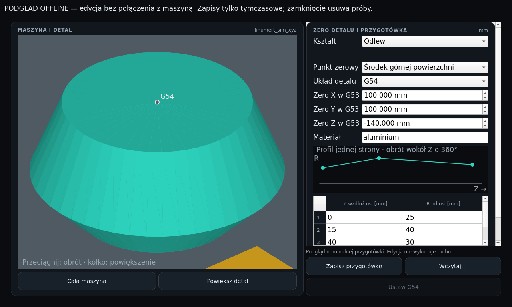

<div align="center">


# THE NEXT FACE OF CNC CONTROL

### One machine. Four interfaces. Your way to work.

**An open-source CNC operator environment built on LinuxCNC.**  
From machining and toolpaths to machine simulation, diagnostics and digital twins.

[**⚡ Quick Start**](#szybki-start-linux-z-podmanem-np-endeavouros) · [**🎛️ Skin System Vision**](#control-has-a-new-face) · [**🧩 Project Roadmap**](docs/design/SKIN_SYSTEM_ROADMAP.md) · [**💻 Source Code**](https://github.com/anonimov94/linumeRT)


</div>

---

## CONTROL HAS A NEW FACE

> **Design goal — completely new operator interfaces, not reskins of the existing QtDragon layout.**
> Each skin will define its own panels, controls, visual hierarchy and placement of the 3D machine, workpiece and toolpath views. A shared CNC core remains underneath.

<table>
<tr>
<td width="50%" valign="top">

### 01 · CLASSIC DIGITAL

**Retro precision. Digital clarity.**

Large seven-segment-inspired DRO readouts, compact rectangular controls and a toolpath-first workspace. Vintage digital instrument aesthetics redesigned as an original CNC interface.

**Layout:** axis readouts on the left · toolpath in the central viewport · machine view on the right.

</td>
<td width="50%" valign="top">

### 02 · INDUSTRIAL PRO

**Built for the shop floor.**

Dense technical information, clear alarms, machine geometry and robust large-format controls. Inspired by the general language of industrial instrumentation, without reproducing another manufacturer's interface.

**Layout:** machine and workpiece views alongside the trajectory, plus a dedicated action console.

</td>
</tr>
<tr>
<td width="50%" valign="top">

### 03 · CYBERDECK

**Operator cockpit of tomorrow.**

Angular frames, illuminated readouts and spacecraft-inspired toggle controls. Modular arrangement of status, G-code, machine simulation and path analysis.

**Layout:** asymmetric cockpit with a large trajectory viewport and secondary machine viewport.

</td>
<td width="50%" valign="top">

### 04 · ORGANIC VECTOR

**Fluid form. Sharp control.**

A futuristic blend of flowing rounded frames, pointed elements, circular indicators and luminous switches. Sci-fi aesthetics with legible technical information.

**Layout:** adaptable floating panels and prominent independent views for machine and toolpath.

</td>
</tr>
</table>

<div align="center">

### FOUR COLOR CONFIGURATIONS — FOR EVERY SKIN


**4 independent GUI layouts × 4 palettes × English / Polski**

[**Explore the complete skin-system design specification →**](docs/design/SKIN_SYSTEM_ROADMAP.md)

</div>

> **Current status (2026-10-23):** four separately composed Qt screens now have their own panel layouts, physical controls, instruments and navigation, with four palettes, English/Polski and three interactive OpenGL panels. This is a separate preview, without CNC status or commands. Complete operator skins and QtVCP integration remain in development. [Original concept artwork](docs/design/referencje-skin/README.md) · [Current screenshots and capture report](docs/raporty/hmi_sym/README.md).

### New skin previews — actual Qt screenshots

| Classic Digital | Industrial Pro |
|:--|:--|
|  |  |
| Cyberdeck | Organic Vector |
|  |  |

Captured as separate screens at **1920×1080**, English: Classic/Organic in Classic Turquoise, Industrial in Reactor Green, Cyberdeck in Ion Blue. All four palettes remain available independently in every screen. The machine and part are illustrative models; unknown readouts and disabled cycle controls are intentional in the offline preview.

```sh
python3 tools/dev/skin-preview.py --skin classic-digital
python3 tools/dev/skin-preview.py --skin industrial-pro --theme reactor-green
python3 tools/dev/skin-preview.py --skin cyberdeck --theme ion-blue
python3 tools/dev/skin-preview.py --skin organic-vector
# Browse all screens, or run without OpenGL dependencies:
python3 tools/dev/skin-preview.py
python3 tools/dev/skin-preview.py --skin organic-vector --layout-only
```

---

## BUILT AROUND REAL MACHINING WORKFLOWS

<table>
<tr>
<td width="50%" valign="top">

#### ◈ CNC OPERATOR EXPERIENCE
Start → homing → work offsets → tools → G-code → simulation → production. Consistent operator feedback, clear machine states and alarm visibility.

#### ◈ DIGITAL TWIN
An independently simulated machine (Plant), axis drives, end stops, spindle and virtual machining scenarios — useful for testing before connecting real hardware.

</td>
<td width="50%" valign="top">

#### ◈ MACHINING SIMULATION
Stock-removal previews, tool geometry, diagnostics and toolpath visualization. A separate depth-buffer OpenGL prototype has passed geometry, visibility and embedded-layout checks on Radeon/Mesa and Debian/llvmpipe; production integration remains open.

#### ◈ OPEN ENGINEERING
LinuxCNC 2.9, HAL, Python and QtVCP integration, reproducible tests, and the GPL-2.0-or-later source code.

</td>
</tr>
</table>

<div align="center">

### CURRENT PROJECT PREVIEWS


<sub>Actual LinuxCNC HMI · fresh capture 2026-10-23 · <a href="docs/raporty/hmi_sym/README.md">capture report</a>. This is separate from the new offline skin previews above.</sub>



<sub>Current implementation — workpiece setup preview.</sub>

</div>

---

## NEXT MILESTONE: A MODULAR OPERATOR COCKPIT

| Phase | Engineering objective |
|:--|:--|
| **SKIN-00** | Confirm architecture and compatibility constraints |
| **SKIN-01** | Offline renderer verified; production integration remains open |
| **SKIN-02** | Build modular skin API, manifests and safe layout selection |
| **SKIN-03** | Implement four palettes and English/Polski localization |
| **SKIN-04** | Deliver Classic Digital and Industrial Pro |
| **SKIN-05** | Deliver Cyberdeck and Organic Vector |
| **SKIN-06** | Validate the full 16-combination matrix and LinuxCNC/Plant integration |

**Safety:** the graphical interface does not replace a hardware E-STOP or certified safety chain. New layouts must preserve visible alarm states and follow LinuxCNC/HAL interlocks. Hardware operation remains **unverified**.

**[Full skin-engineering roadmap →](docs/design/SKIN_SYSTEM_ROADMAP.md)**

---

## RUN THE CURRENT linumeRT

The existing LinuxCNC/QtDragon-based HMI and Plant simulator remain available during research and development of the replacement GUI. Below are the current launch instructions, project status and technical details.

## Obraz live USB / ISO (komputer maszyny)

Gotowy system do wypalenia na pendrive: **Debian 12 + jądro PREEMPT_RT + LinuxCNC 2.9 + linumeRT**.
Uruchom bez instalacji (tryb live: ekran linumeRT na symulatorze, „linumeRT + Plant” z wirtualną
obrabiarką) albo zainstaluj na dysk komputera maszyny (Calamares).

- Pobierz z [Releases](https://github.com/anonimov94/linumeRT/releases): wydania `v*` oraz obrazy robocze
  `iso-RRRRMMDD-<commit>` (pre-release, zostają na stałe). Nowy obraz na żądanie:
  [Actions → ISO live USB](https://github.com/anonimov94/linumeRT/actions/workflows/iso.yml) → **Run workflow** (ok. 30–60 min).
- Sprawdź sumę: `sha256sum -c linumert-*.iso.sha256`.
- Wypal: `sudo dd if=linumert-*.iso of=/dev/sdX bs=4M status=progress conv=fsync` albo Etcher / Ventoy.
- Przed pracą na maszynie: test latencji (`latency-histogram`) — nie każdy komputer nadaje się do RT.
  NIEZWERYFIKOWANE NA SPRZĘCIE.

## Szybki start (Linux z podmanem, np. EndeavourOS)

Jedno polecenie pobiera `main` z GitHuba do `~/linumeRT`, instaluje `git` i `podman` (pacman/dnf/apt, z sudo),
buduje kontener Debian 12 z LinuxCNC 2.9 (pakiety linuxcnc.org) i otwiera okno LinuxCNC z ekranem linumeRT
na symulatorze:

```bash
bash <(curl -fsSL https://raw.githubusercontent.com/anonimov94/linumeRT/main/tools/linumert-start.sh)
```

Kolejne uruchomienia: z menu aplikacji („linumeRT”, „linumeRT + Plant”) albo `~/linumeRT/tools/linumert-start.sh`
(przy każdym starcie `git pull` main). Opcje:

| Polecenie | Co uruchamia |
|---|---|
| `tools/linumert-start.sh` | symulator LinuxCNC + ekran linumeRT |
| `tools/linumert-start.sh --plant` | + wirtualna obrabiarka Plant przez LRT-NET; panel Plant otwiera się w przeglądarce (http://127.0.0.1:8080/) |
| `tools/linumert-start.sh --plant --vfd` | jak wyżej, wrzeciono przez falownik (`hy_vfd`) |
| `tools/linumert-start.sh --classic` | czysty QtDragon (bez nakładki linumeRT) |
| `--no-update`, `--rebuild`, `--shell`, `--desktop`, `--dir KATALOG` | bez aktualizacji, nowy obraz kontenera, powłoka w kontenerze, tylko skróty w menu, inne repozytorium |

Pierwsze uruchomienie trwa kilka minut (obraz ok. 1,5 GB), kolejne kilkanaście sekund. W oknie: **Start** →
„Potwierdź grzybem” → „Włącz” → „Bazuj wszystkie”. W **Symulacja** przycisk
**Uruchom / Reset symulacji → HOME** przygotowuje bliźniaka po potwierdzeniu operatora.
JOG, MDI, wrzeciono M3/M4/M5 i **WYMIANA M6** są dostępne w **Maszyna** i **Symulacja**.
Na górze są trzy ostatnie alarmy i Reset. [Pełna instrukcja](docs/OBSLUGA_OPERATORA.md).

Sam edytor przygotówki bez uruchamiania LinuxCNC: `bash tools/dev/preview-zero.sh`.
To podgląd offline z zapisami tymczasowymi. [Zero detalu](docs/ZERO_DETALU.md).


## Co już działa (bez sprzętu, LinuxCNC 2.9 na Debianie 12)

| Obszar | Stan | Gdzie |
|---|---|---|
| LinuxCNC + ekran | symulator 3 osi z ekranem linumert (kopia bazowa QtDragon 2.9.10) | `config/sim/`, `screens/linumert/` |
| Wirtualna obrabiarka Plant | dynamika osi w C, napędy CiA 402 i krokowce, biblioteka napędów, kinematyka, krańcówki, zderzaki, bazowanie, magazyn narzędzi, kolizje, wrzeciono z falownikiem | `plant/`, [`docs/PLANT.md`](docs/PLANT.md) |
| LinuxCNC ↔ Plant | komponenty HAL `lrt_net` / `lrt_cia402`; bazowanie z losowego startu, ruch G1, wyrocznia soft limits i stref, wrzeciono przez `hy_vfd` | `hal/`, `config/plant/` |
| Rdzeń (Python) | model stanu maszyny, katalog alarmów PL/EN, `machine.yaml`, baza narzędzi, format `.lnx` i kompilator do `.ngc`, lekser G-code | `core/linumert/` |
| Ekran HMI linumeRT (D32, D34) | własne widoki workflow, trzy alarmy i Reset, JOG/MDI, wrzeciono, wymiana M6, tryb specjalisty, Zero detalu 3D i konfiguracja przygotówki | `screens/linumert/`, [`docs/design/HMI_WORKFLOW.md`](docs/design/HMI_WORKFLOW.md) |
| Uruchomienie jednym poleceniem | `tools/linumert-start.sh` (podman, Debian 12, LinuxCNC 2.9) | „Szybki start” wyżej |
| Symulacja materiału i kolizji | materiał 2.5D na żywo, 11 typów narzędzi, kolizje K-301…K-309, przeciążenia z granic napędów, eksport STL, wirtualne wycofanie po kolizji | `simulation/`, [`docs/HMI_SYMULACJA.md`](docs/HMI_SYMULACJA.md) |
| Bezpieczeństwo | grzyb HMI w łańcuchu E-STOP (D35), watchdog ekranu, dwukanałowy E-STOP NC `lrt_estop2` | `config/hal/`, `hal/lrt_estop2.comp` |
| Program i cykle | wybór, podgląd, sprawdzanie składni, edycja; generatory: nagłówek, narzędzie, planowanie, otwory, koniec | `screens/linumert/`, `core/linumert/generators/` |

Skróty w menu aplikacji: **linumeRT**, **linumeRT + Plant**, **linumeRT — QtDragon**.
Instalacja bez uruchamiania CNC: `bash tools/linumert-start.sh --desktop --dir ~/linumeRT`.
Skróty wskazują wybrane repozytorium; przy uruchomieniu główna gałąź aktualizuje się przez fast-forward.

## Co dalej (najbliższe zadania)

Polecenie właściciela: kończymy rozpoczęte zakresy. [Lista brakujących funkcji na 21–27.10.2026](docs/PLAN_TYGODNIA_2026-10-21.md).
[Raport odbioru P0 i testów HMI](docs/raporty/prototypy/P0-2026-10-20.md).

1. **Wznowienie obróbki (D38)** — wycofanie w pauzie, powrót po helisie i łuku stycznym z zakładką,
   bez naddatku ([`docs/design/WZNOWIENIE.md`](docs/design/WZNOWIENIE.md), sesja 031).
2. Raport symulacji HTML i oś czasu zdarzeń (059, 057); symulacja programu offline przed startem (051–056).
3. Programy dialogowe: kieszenie, rowki, kontur, pliki `.lnx`, walidacja z bazą narzędzi (040–047).
4. Tryby, MDI, alarmy, poziomy dostępu, PL/EN na ekranie (029–037).
5. Generator konfiguracji: step/dir, EtherCAT, RS485, 4/5 osi, ATC, kreator maszyny (061–067).
6. Wtyczki, instalator Debian 12 i **obraz live USB / ISO** do wypalenia (Debian 12 + RT + LinuxCNC + linumeRT),
   dokumentacja użytkownika, wydanie v0.5.0-alpha (073–083).

Pełny plan sesji: [`prompts/README.md`](prompts/README.md).

## Kierunek rozwoju

Docelowy ekran operatora to HMI zorganizowane według kolejności pracy przy maszynie: Start → Bazowanie →
Zero detalu → Narzędzia → Program → Symulacja → Produkcja, a obok Ręczne/MDI, Diagnostyka i Ustawienia,
ze stałym paskiem stanu, DRO i alarmami (decyzja D32, [`docs/design/HMI_WORKFLOW.md`](docs/design/HMI_WORKFLOW.md)).
Powstaje etapami HMI-01…HMI-06 na bazie obecnego ekranu QtDragon, bez zmiany sterowania LinuxCNC.

## Architektura
```
VM-A / komputer maszyny                         VM-B (Plant)
┌───────────────────────────────┐   LRT-NET    ┌──────────────────────────────┐
│ Ekran linumeRT (QtVCP)        │   UDP 1 kHz  │ model osi + napędy CiA 402   │
│ rdzeń linumert (Python)       │◄────────────►│ I/O, sonda, VFD, ATC, MPG    │
│ LinuxCNC 2.9 + HAL (lrt_net)  │  RS485/pty   │ panel web, scenariusze       │
└───────────────────────────────┘ (hy_vfd)     └──────────────────────────────┘
Na prawdziwej maszynie lrt_net zastępuje lcec (EtherCAT) lub stepgen — sygnały HAL bez zmian.
```

W 10 linijkach:
1. **LinuxCNC 2.9** jest jedynym interpreterem G-code i planerem ruchu; linumeRT go nie zastępuje.
2. **HAL** łączy LinuxCNC z napędami; kontrakt sygnałów `linumert.*` opisuje [`docs/HAL_KONTRAKT.md`](docs/HAL_KONTRAKT.md).
3. W czasie rzeczywistym działają tylko komponenty `hal/*.comp`: bez alokacji i bez blokującego I/O.
4. **Ekran** `screens/linumert/` to kopia QtDragon (QtVCP); własna logika w handlerze i osobnych modułach.
5. Ekran czyta stan przez `linuxcnc.stat` i wydaje polecenia przez `linuxcnc.command`, tak jak QtDragon.
6. **Rdzeń** `core/linumert/` (Python, bez UI): alarmy, narzędzia, `.lnx`, generatory, `machine.yaml`.
7. Rdzeń generuje wyłącznie tekst G-code i dane; ekran i narzędzia go importują.
8. **Plant** (`plant/`) to wirtualna obrabiarka: dynamika i napędy w C, serwer i wyrocznia w Pythonie.
9. LinuxCNC rozmawia z Plant przez **LRT-NET** (UDP, 1 kHz) i falownik przez RS485/pty (`hy_vfd`).
10. Jedna maszyna = jeden `machine.yaml`: z niego Plant buduje obrabiarkę, a test pilnuje zgodności INI LinuxCNC.

## Szybki start

Rdzeń i Plant bez LinuxCNC (Python ≥ 3.11, `make`, kompilator C):
```bash
python3 -m venv .venv && . .venv/bin/activate
make install      # pakiet linumert + zależności dev (pytest, ruff)
make lint test    # ruff i pytest bez LinuxCNC
make test-c       # testy rdzenia Plant w C (make test-san: z ASan/UBSan)
```
W systemowym Pythonie Debiana dodaj `PIP_FLAGS=--break-system-packages`. Wyniki wiążące: Debian 12
(`tools/dev/debian-container.sh make lint test test-c`).

LinuxCNC z wirtualną obrabiarką na pulpicie (podman, LinuxCNC 2.9 zbudowany według
[`docs/PLANT_START.md`](docs/PLANT_START.md)):
```bash
tools/dev/plant-gui.sh          # LinuxCNC + Plant + ekran linumert
VFD=1 tools/dev/plant-gui.sh    # wariant z wrzecionem przez hy_vfd i emulator falownika
```

## Dokumentacja

Pełny spis: [`docs/README.md`](docs/README.md). Agent AI zaczyna od [`docs/PROMPT_NOWEJ_SESJI.md`](docs/PROMPT_NOWEJ_SESJI.md). Najważniejsze: stan bieżący i plan scalania
[`docs/NASTEPNA_SESJA.md`](docs/NASTEPNA_SESJA.md) · decyzje [`docs/DECYZJE.md`](docs/DECYZJE.md) ·
dziennik [`docs/DZIENNIK.md`](docs/DZIENNIK.md) · wymagania [`docs/wymagania/`](docs/wymagania/) ·
wytyczne IP [`docs/prawne/WYTYCZNE_IP.md`](docs/prawne/WYTYCZNE_IP.md).

## Jak powstaje
Kod piszą agenci AI (Claude, Codex) według promptów sesji w [`prompts/`](prompts/README.md) i kontraktu
[`CLAUDE.md`](CLAUDE.md); zasady współpracy: [`docs/WSPOLPRACA_MODELI.md`](docs/WSPOLPRACA_MODELI.md).
Każda zmiana przechodzi przez pull request z oznaczeniem modelu-autora (`Model-Author:`).

Na Windows z WSL jest wspólna paczka testowa z podglądem VNC: [`tools/agent_tests`](tools/agent_tests/README.md).

## Licencja
GPL-2.0-or-later dla własnego kodu. Części pochodzące z LinuxCNC/QtDragon: GPL-2.0. Całość jest rozpowszechniana
na GPL-2.0 (pełny tekst w [`LICENSE`](LICENSE), zależności w [`docs/LICENCJE.md`](docs/LICENCJE.md), pochodzenie
zasobów w [`docs/PROVENANCE.md`](docs/PROVENANCE.md)). Licencja z katalogu nadrzędnego (`PythonProjects/LICENSE`)
nie dotyczy tego projektu.

## Plan rozwoju: nowe skórki operatora

Planowany jest **zupełnie nowy, wymienny interfejs HMI** z czterema autorskimi rodzinami skórek: Classic Digital, Industrial Pro, Cyberdeck i Organic Vector. Każda będzie obsługiwać cztery niezależne palety (turkusowa, grafitowa, zielona, niebieska), języki English/Polski oraz konfigurowalne rozmieszczenie widoków maszyny 3D, detalu i ścieżki. Etap wymaga nowego, zweryfikowanego renderera 3D i zachowania bezpieczeństwa LinuxCNC/HAL.

**Status: roadmapa i wytyczne — jeszcze nie wdrożono.** Szczegóły: [SKIN_SYSTEM_ROADMAP.md](docs/design/SKIN_SYSTEM_ROADMAP.md).
