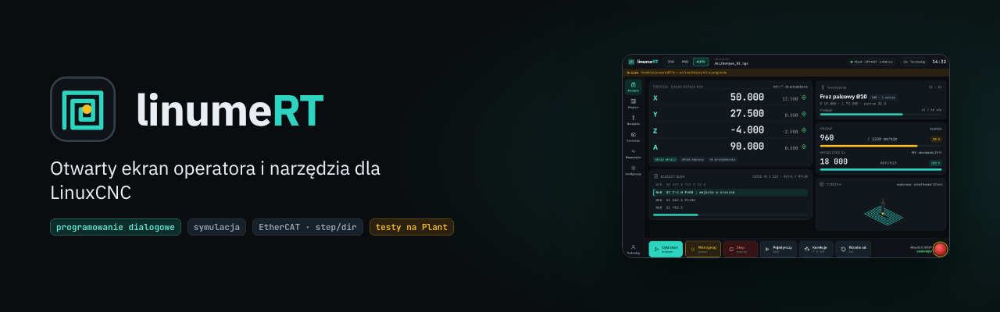

# linumeRT



Otwarty ekran operatora i zestaw narzędzi dla **LinuxCNC**, przeznaczony dla hobbystycznych maszyn CNC:
frezarek 3, 4 i 5 osi, silników krokowych, serw krokowych i serw, ręcznej zmiany narzędzia i ATC,
napędów EtherCAT (CiA 402) i step/dir oraz wrzecion sterowanych przez RS485.

Ekran powstaje na bazie **QtDragon** (QtVCP, część LinuxCNC). Ma mieć własny wygląd, programowanie dialogowe,
symulację z kolizjami, kreator konfiguracji i diagnostykę napędów. Do testów służy **Plant**, czyli
wirtualna frezarka w osobnej maszynie wirtualnej. Symuluje bezwładność, ograniczenia momentu i przyspieszenia,
napędy, krańcówki, sondę, falownik i magazyn narzędzi.

> **Status:** wczesny rozwój: 23 z 84 sesji planu ([postęp](prompts/README.md)). Nic nie zostało sprawdzone
> na prawdziwej maszynie.

## Co już działa (bez sprzętu, LinuxCNC 2.9 na Debianie 12)

| Obszar | Stan | Gdzie |
|---|---|---|
| LinuxCNC + ekran | symulator 3 osi z ekranem linumert (kopia bazowa QtDragon 2.9.10) | `config/sim/`, `screens/linumert/` |
| Wirtualna obrabiarka Plant | dynamika osi w C, napędy CiA 402 i krokowce, biblioteka napędów, kinematyka, krańcówki, zderzaki, bazowanie, magazyn narzędzi, kolizje, wrzeciono z falownikiem | `plant/`, [`docs/PLANT.md`](docs/PLANT.md) |
| LinuxCNC ↔ Plant | komponenty HAL `lrt_net` / `lrt_cia402`; bazowanie z losowego startu, ruch G1, wyrocznia soft limits i stref, wrzeciono przez `hy_vfd` | `hal/`, `config/plant/` |
| Rdzeń (Python) | model stanu maszyny, katalog alarmów PL/EN, `machine.yaml`, baza narzędzi, format `.lnx` i kompilator do `.ngc`, lekser G-code | `core/linumert/` |
| HMI według kolejności pracy (D32) | projekt gotowy, implementacja HMI-01…06 | [`docs/design/HMI_WORKFLOW.md`](docs/design/HMI_WORKFLOW.md) |
| Własny wygląd ekranu, programy dialogowe, symulacja materiału, generator konfiguracji | zaplanowane (kamienie M2–M6) | [`prompts/README.md`](prompts/README.md) |

## Kierunek rozwoju

Docelowy ekran operatora to HMI zorganizowane według kolejności pracy przy maszynie: Start → Bazowanie →
Zero detalu → Narzędzia → Program → Symulacja → Produkcja, a obok Ręczne/MDI, Diagnostyka i Ustawienia,
ze stałym paskiem stanu, DRO i alarmami (decyzja D32, [`docs/design/HMI_WORKFLOW.md`](docs/design/HMI_WORKFLOW.md)).
Powstaje etapami HMI-01…HMI-06 na bazie obecnego ekranu QtDragon, bez zmiany sterowania LinuxCNC.

## Architektura
```
VM-A / komputer maszyny                         VM-B (Plant)
┌───────────────────────────────┐   LRT-NET    ┌──────────────────────────────┐
│ Ekran linumeRT (QtVCP)        │   UDP 1 kHz  │ model osi + napędy CiA 402   │
│ rdzeń linumert (Python)       │◄────────────►│ I/O, sonda, VFD, ATC, MPG    │
│ LinuxCNC 2.9 + HAL (lrt_net)  │  RS485/pty   │ panel web, scenariusze       │
└───────────────────────────────┘ (hy_vfd)     └──────────────────────────────┘
Na prawdziwej maszynie lrt_net zastępuje lcec (EtherCAT) lub stepgen — sygnały HAL bez zmian.
```

## Szybki start

Rdzeń i Plant bez LinuxCNC (Python ≥ 3.11, `make`, kompilator C):
```bash
python3 -m venv .venv && . .venv/bin/activate
make install      # pakiet linumert + zależności dev (pytest, ruff)
make lint test    # ruff i pytest bez LinuxCNC
make test-c       # testy rdzenia Plant w C (make test-san: z ASan/UBSan)
```
W systemowym Pythonie Debiana dodaj `PIP_FLAGS=--break-system-packages`. Wyniki wiążące: Debian 12
(`tools/dev/debian-container.sh make lint test test-c`).

LinuxCNC z wirtualną obrabiarką na pulpicie (podman, LinuxCNC 2.9 zbudowany według
[`docs/PLANT_START.md`](docs/PLANT_START.md)):
```bash
tools/dev/plant-gui.sh          # LinuxCNC + Plant + ekran linumert
VFD=1 tools/dev/plant-gui.sh    # wariant z wrzecionem przez hy_vfd i emulator falownika
```

## Dokumentacja

Pełny spis: [`docs/README.md`](docs/README.md). Agent AI zaczyna od [`docs/PROMPT_NOWEJ_SESJI.md`](docs/PROMPT_NOWEJ_SESJI.md). Najważniejsze: stan bieżący i plan scalania
[`docs/NASTEPNA_SESJA.md`](docs/NASTEPNA_SESJA.md) · decyzje [`docs/DECYZJE.md`](docs/DECYZJE.md) ·
dziennik [`docs/DZIENNIK.md`](docs/DZIENNIK.md) · wymagania [`docs/wymagania/`](docs/wymagania/) ·
wytyczne IP [`docs/prawne/WYTYCZNE_IP.md`](docs/prawne/WYTYCZNE_IP.md).

## Jak powstaje
Kod piszą agenci AI (Claude, Codex) według promptów sesji w [`prompts/`](prompts/README.md) i kontraktu
[`CLAUDE.md`](CLAUDE.md); zasady współpracy: [`docs/WSPOLPRACA_MODELI.md`](docs/WSPOLPRACA_MODELI.md).
Każda zmiana przechodzi przez pull request z oznaczeniem modelu-autora (`Model-Author:`).

Na Windows z WSL jest wspólna paczka testowa z podglądem VNC: [`tools/agent_tests`](tools/agent_tests/README.md).

## Licencja
GPL-2.0-or-later dla własnego kodu. Części pochodzące z LinuxCNC/QtDragon: GPL-2.0. Całość jest rozpowszechniana
na GPL-2.0 (pełny tekst w [`LICENSE`](LICENSE), zależności w [`docs/LICENCJE.md`](docs/LICENCJE.md), pochodzenie
zasobów w [`docs/PROVENANCE.md`](docs/PROVENANCE.md)). Licencja z katalogu nadrzędnego (`PythonProjects/LICENSE`)
nie dotyczy tego projektu.
