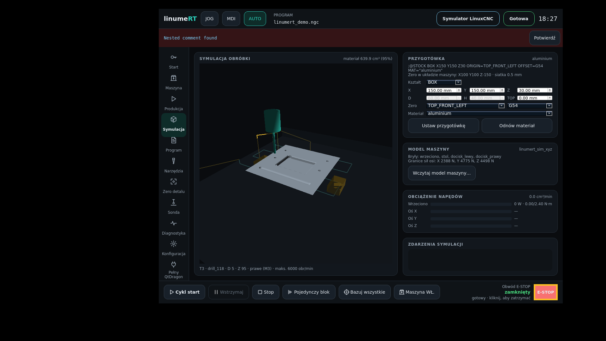
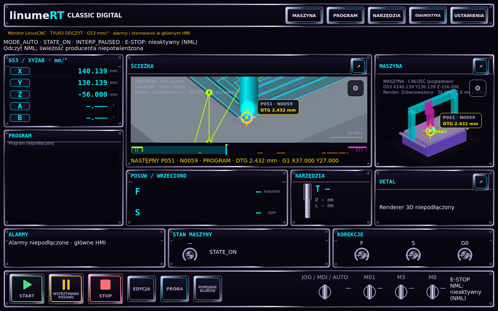
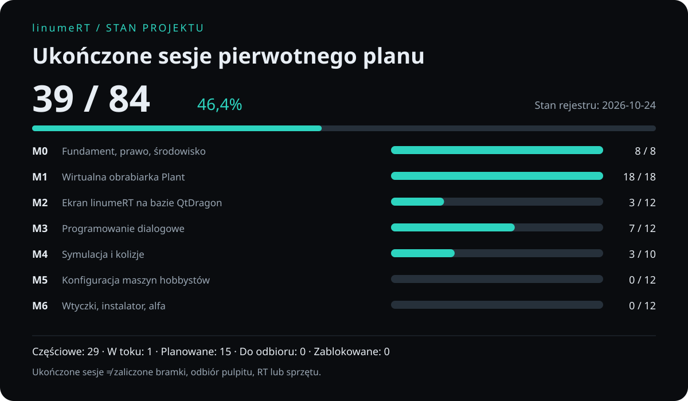
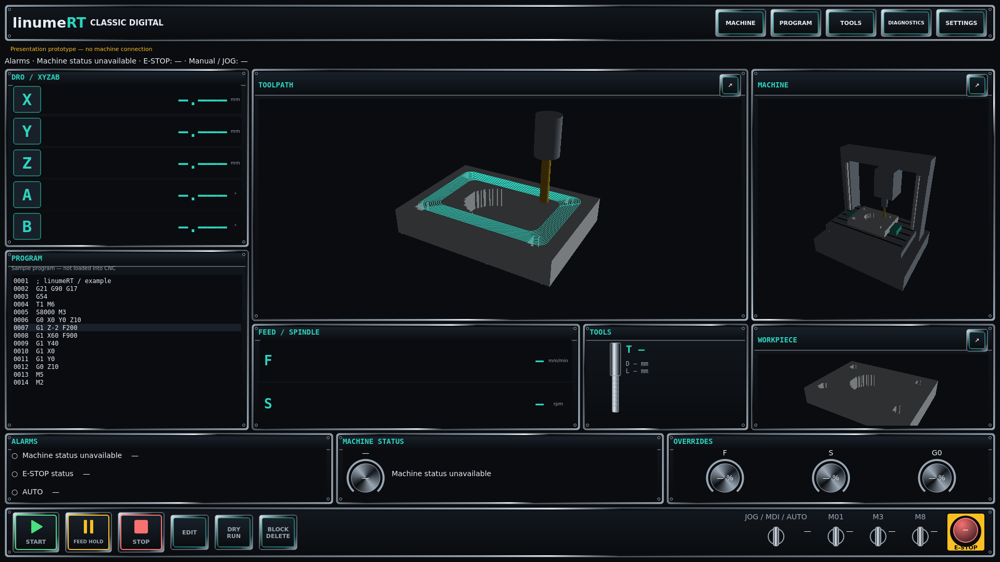
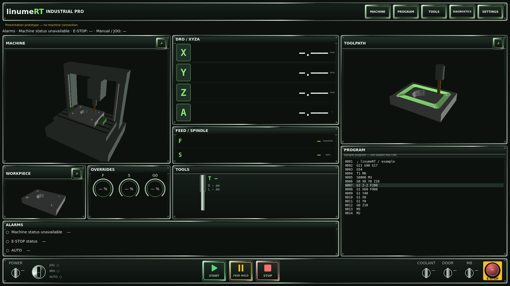
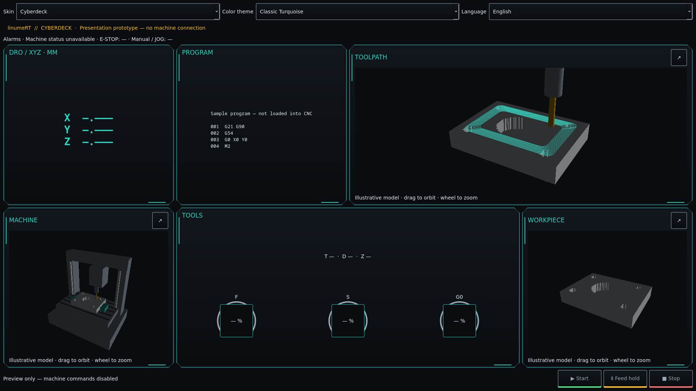
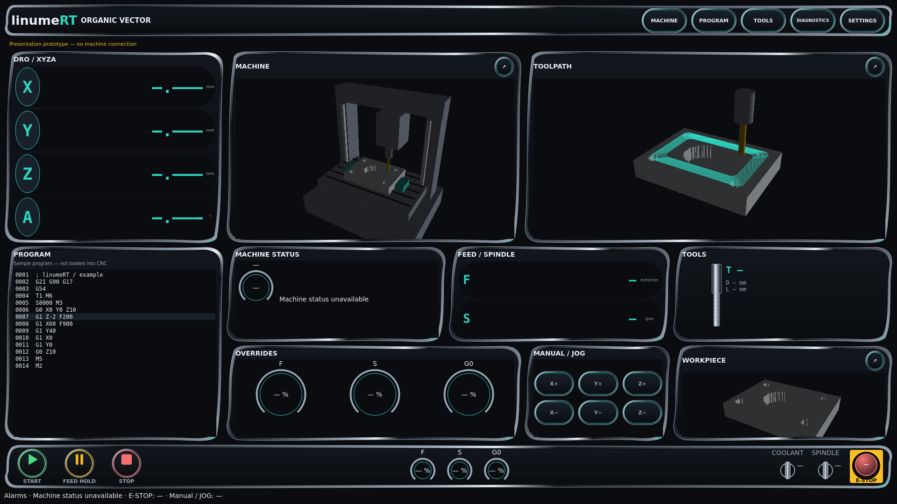

<div align="center">


# linumeRT

### Sterowanie CNC · wirtualna obrabiarka · programowanie obróbki

Otwarte środowisko operatora oparte na **LinuxCNC 2.9**, **QtVCP** i **Debianie 12**.
Własny interfejs, podgląd detalu i ścieżki oraz Plant — model maszyny do badania jej zachowania.

[**Pobierz ISO Live**](https://github.com/anonimov94/linumeRT/releases) · [**Uruchom projekt**](#uruchomienie-na-linuxie) · [**Kamienie milowe**](#kamienie-milowe) · [**Dokumentacja**](docs/README.md)


</div>

## Zobacz działający ekran



Rzeczywisty zrzut HMI z LinuxCNC 2.9, 25.10.2026 (po obróbce programu demonstracyjnego, 673,8 cm³ materiału) — nie makieta.
[Przebieg demonstracyjny i dowody](docs/raporty/hmi_sym/README.md).

### Classic × Neon: podgląd programu na żywo



Monitor tylko do odczytu obok LinuxCNC (sim) w trybie AUTO, program wstrzymany w środku: numer linii, następny punkt
i DTG (2,432 mm) oraz pozycja DRO zgadzają się z danymi LinuxCNC. Pomiary i opis: [raport odbioru](docs/raporty/neon/README.md).

## Co oferuje linumeRT

| Obszar | Dostępne możliwości |
|---|---|
| Obsługa maszyny | Bazowanie, JOG, MDI, AUTO, narzędzia, wrzeciono, ręczna zmiana narzędzia, alarmy i Reset w ekranie opartym na QtDragon. |
| Programowanie | Programy `.lnx`, generatory cykli, edytor G-code, podgląd programu i sprawdzanie ograniczeń. |
| Detal i ścieżka | Definicja przygotówki i zera detalu, narzędzia, podgląd obróbki oraz diagnostyka materiału i kolizji. |
| Plant | Dynamika osi i napędów, masa i bezwładność, CiA402, krokowce, krańcówki, bazowanie, magazyn narzędzi i wrzeciono. |
| Konfiguracja | Wspólny `machine.yaml`, biblioteka napędów, generator INI/HAL, podgląd zmian i kopia zapasowa konfiguracji. |
| Diagnostyka | Raporty scenariuszy, testy LinuxCNC ↔ Plant i opcjonalny ślad HAL z cyklu serwo. |
| Interfejsy | Cztery autorskie układy skórek, motywy i PL/EN; podglądy oraz osobne monitory odczytu statusu LinuxCNC. |

**Dostępna implementacja nie oznacza odbioru całego obszaru.** Pozostałe kryteria, zależności i dowody są w [rejestrze projektu](docs/roadmap/PLAN.md).

### Plant: znajdź granice swojej maszyny

Plant ma odtwarzać rzeczywistą odpowiedź maszyny: bezwładność, opóźnienie napędu, uchyb nadążania, przeregulowanie i hamowanie. Pomaga badać, jak prędkość, przyspieszenie, obciążenie i nastawy wpływają na ruch.

Celem jest **największa użyteczna dynamika podczas G0 i bardzo szybkich ruchów roboczych przy kontrolowanym uchybie**. Sam fizyczny uchyb nie jest błędem modelu. LinuxCNC pozostaje jedynym interpreterem G-code i planerem ruchu.

[Model i protokół Plant](docs/PLANT.md) · [Uruchomienie](docs/PLANT_START.md) · [Odbiór G1](docs/raporty/G1.md)

### Ostatnie potwierdzone zmiany

- Diagnostyka zachowuje konfigurację, logi LinuxCNC/Plant i dane uchybu także po nieudanej próbie.
- Opcjonalny sampler zapisuje 21 kanałów X/Z, CiA402 i LRT-NET na końcu cyklu serwo, z kontrolą ciągłości danych.
- Runner scenariuszy czeka na gotowość wszystkich napędów przed bazowaniem; test odbioru sprawdza pierwsze bazowanie bez retry.
- Generator konfiguracji tworzy warianty sim/Plant i mapowania sprzętowe z podglądem zmian oraz backupem. Weryfikacja fizycznego sprzętu pozostaje osobnym krokiem.

Dowody: [diagnostyka i rampy](docs/raporty/prototypy/M1_FIRST_MOTION_2026-10-25.md), [ślad serwo](docs/raporty/prototypy/M1_SERVO_TRACE_2026-10-25.md), [gotowość napędów](docs/raporty/prototypy/M1_DRIVE_READY_2026-10-25.md).

## Przetestuj na laptopie — ISO Live

Obraz **amd64 (Intel/AMD 64-bit)** zawiera Debian 12, jądro PREEMPT_RT, LinuxCNC 2.9, pulpit XFCE i linumeRT. Tryb Live pozwala przetestować interfejs i symulację z pendrive’a bez instalowania systemu na dysku laptopa.

1. Pobierz `.iso` i odpowiadający mu plik `.iso.sha256` z [wydań testowych](https://github.com/anonimov94/linumeRT/releases). Nazwa wydania `iso-RRRRMMDD-SHA` wskazuje datę i commit źródeł.
2. Sprawdź sumę SHA-256, a następnie zapisz ISO jako obraz na pendrive.
3. Uruchom laptop z USB i wybierz tryb **Live**. Instalator Calamares jest osobną opcją.
4. Pulpit loguje się automatycznie. Konto Live: **`linumert`**, hasło **`live`**.
5. Na pulpicie są skróty: **linumeRT (symulator)**, **linumeRT + Plant**, **linumeRT Monitor Neon** i **linumeRT: zatrzymaj**. Symulator startuje sam po zalogowaniu; skrót Plant sam zatrzymuje go i uruchamia od nowa. Błąd startu pokazuje okno terminala z końcem dziennika.

Weryfikacja w Linuxie, w katalogu pobranych plików:

```sh
sha256sum -c linumert-*.iso.sha256
```

W PowerShell porównaj wynik z zawartością pobranego pliku `.sha256`:

```powershell
Get-FileHash .\linumert-*-amd64.iso -Algorithm SHA256
```

| Wpis w menu | Przeznaczenie |
|---|---|
| linumeRT | Ekran operatora z symulatorem LinuxCNC. |
| linumeRT + Plant | Wirtualna obrabiarka i panel Plant w przeglądarce. |
| Monitor skórek | Osobny monitor działającego LinuxCNC, tylko odczyt. |
| Classic × Neon | Monitor detalu i maszyny z podglądem ścieżki, tylko odczyt. |

Z terminala (po zalogowaniu jako `linumert`):

```sh
linumert --restart          # symulator od nowa
linumert --restart --plant  # Plant + panel http://127.0.0.1:8080/
linumert --stop             # zatrzymaj LinuxCNC i Plant
```

Samo `linumert` przy już działającym symulatorze (start przy logowaniu) kończy się komunikatem, że LinuxCNC już działa; użyj wtedy `--restart`.

Najpierw uruchom symulator lub Plant, potem wybrany monitor. Próbę laptopa warto zacząć od grafiki, klawiatury, sieci, bazowania i krótkiego programu demonstracyjnego.

**Odbiór laptopa jest nadal potrzebny:** start Live, Wi-Fi/grafika, instalacja i pomiar latencji. Budowa obrazu w CI nie kwalifikuje komputera do sterowania fizyczną maszyną. [Procedura odbioru stanowiska](docs/raporty/ODBIOR_STANOWISKA.md).

## Uruchomienie na Linuxie

**Szybki start:** starter pobiera projekt do `~/linumeRT` i uruchamia ekran przez kontener Debian 12 z LinuxCNC. Obsługuje systemy z menedżerem pacman, dnf lub apt; pierwsze uruchomienie instaluje zależności i buduje obraz.

```sh
bash <(curl -fsSL https://raw.githubusercontent.com/anonimov94/linumeRT/main/tools/linumert-start.sh)
```

Kolejne uruchomienia:

```sh
~/linumeRT/tools/linumert-start.sh          # symulator i ekran
~/linumeRT/tools/linumert-start.sh --plant  # wirtualna obrabiarka Plant
```

W ekranie: **Start → potwierdzenie E-STOP → Włącz → Bazuj wszystkie**. Dalsza obsługa: [instrukcja operatora](docs/OBSLUGA_OPERATORA.md).

## Kamienie milowe



<!-- MILESTONES:START -->
<!-- Generowane przez tools/roadmap.py z plan.json. -->

Stan rejestru: **2026-10-25 · 39/84 ukończonych sesji**.

| Kamień | Zakres | Sesje ukończone | Rekordy z otwartymi kryteriami |
|---|---|---:|---:|
| M0 | Fundament, prawo, środowisko | 8/8 | 1 |
| M1 | Wirtualna obrabiarka Plant | 18/18 | 3 |
| M2 | Ekran linumeRT na bazie QtDragon | 3/12 | 25 |
| M3 | Programowanie dialogowe | 7/12 | 7 |
| M4 | Symulacja i kolizje | 3/10 | 12 |
| M5 | Konfiguracja maszyn hobbystów | 0/12 | 11 |
| M6 | Wtyczki, instalator, alfa | 0/12 | 9 |

Licznik sesji nie oznacza zaliczenia bramki, odbioru stanowiska ani sprzętu. Otwarte kryteria obejmują sesje i powiązane rozszerzenia; jedno rozszerzenie może dotyczyć kilku kamieni.

[Pełny plan, kryteria i dowody](docs/roadmap/PLAN.md) · [Roadmapa HTML](docs/roadmap/index.html) · [Źródłowy rejestr](docs/roadmap/plan.json)
<!-- MILESTONES:END -->

Wcześniejsze bramki pozostają priorytetem rozwoju. Automatyczne testy, odbiór pulpitu, kwalifikacja RT i sprawdzenie na sprzęcie mają osobne wyniki. Bieżące zadania są opisane przy odpowiednich rekordach planu.

## Cztery kierunki interfejsu

**Classic Digital · Industrial Pro · Cyberdeck · Organic Vector** korzystają ze wspólnego rdzenia, motywów i języków PL/EN. Działający ekran operatora oraz osobne monitory skórek mają różny zakres — monitory odczytu nie wysyłają poleceń ruchu.

<details>
<summary>Galeria układów i dokumentacja projektu skórek</summary>

| Classic Digital | Industrial Pro |
|---|---|
|  |  |
| Cyberdeck | Organic Vector |
|  |  |

Zrzuty podglądów offline z 25.10.2026 (`skin-check.py`, 160 kombinacji PASS). [Raport i odtworzenie galerii](docs/raporty/hmi_sym/README.md) · [Specyfikacja skórek](docs/design/SKIN_SYSTEM_ROADMAP.md).

</details>

## Dokumentacja i rozwój

- [Instrukcja operatora](docs/OBSLUGA_OPERATORA.md) i [Zero detalu](docs/ZERO_DETALU.md).
- [Plant](docs/PLANT.md), [maszyny i szablony napędów](plant/library/drives/README.md).
- [Wymagania i pokrycie](docs/wymagania/MACIERZ.md), [raporty odbioru](docs/raporty/ODBIOR_STANOWISKA.md).
- [Decyzje projektu](docs/DECYZJE.md), [dziennik](docs/DZIENNIK.md), [zasady współpracy](docs/WSPOLPRACA_MODELI.md).

```sh
make install
make lint test test-c test-san
make plant-matrix
# W odrębnym środowisku z LinuxCNC lub pod wspólną blokadą:
make test-linuxcnc
```

Licencja: **GPL-2.0-or-later dla własnego kodu**. Kod LinuxCNC/QtDragon zachowuje swoje nagłówki i licencję GPL-2.0; szczegóły w [LICENSE](LICENSE) i [rejestrze pochodzenia](docs/PROVENANCE.md). Licencja katalogu nadrzędnego nie dotyczy linumeRT.

Ekran nie zastępuje sprzętowego E-STOP/STO. **NIEZWERYFIKOWANE NA SPRZĘCIE.**
