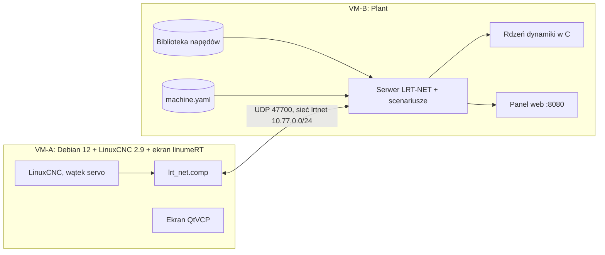

# Plant: specyfikacja wirtualnej obrabiarki

Model-Author: Claude · sesja 009 · wersja 1.0 · 2026-10-18.
Podstawa: `docs/wymagania/WIRTUALNA_OBRABIARKA.md` (REQ-VD, REQ-VM, REQ-QA, obowiązujące),
decyzje D05, D18, D19, D23. Ta specyfikacja opisuje, **jak** zrealizujemy każde REQ w sesjach
010–026; macierz statusów: `docs/wymagania/MACIERZ.md`. **NIEZWERYFIKOWANE NA SPRZĘCIE:**
model jest uproszczeniem, parametry w przykładach są typowe, nie pomiarowe.

## 1. Cel i zakres
Plant zachowuje się jak fizyczna maszyna DIY: przyjmuje zadane pozycje z LinuxCNC (przez
komponent HAL `lrt_net`), liczy dynamikę osi, napędów i wejść/wyjść, zwraca stan. Pozwala
testować prototypy bez sprzętu i jest **wyrocznią testową** (REQ-VM-06). Plant nie jest
funkcją bezpieczeństwa i nie zastępuje testów na prawdziwej maszynie.

## 2. Architektura

- **Wariant sieciowy:** VM-A i VM-B w sieci wewnętrznej `lrtnet` (10.77.0.0/24), tryb `--realtime`.
- **Wariant lokalny (CI, WSL):** oba procesy na `127.0.0.1`, tryb `--lockstep`.
- **Tryby serwera:** `--realtime` (krok modelu wyzwala przychodząca ramka, odpowiedź natychmiast)
  i `--lockstep` (czas pochodzi wyłącznie z pola `time_ns` ramki, bez zegara ściennego: deterministyczny, REQ-QA-04).
- Podział odpowiedzialności: rdzeń C liczy dynamikę osi i napędów; Python orkiestruje
  (protokół, scenariusze, zdarzenia, panel); `machine.yaml` jest jedynym źródłem parametrów (REQ-VM-01).

## 3. Protokół LRT-NET v1 (UDP, port 47700)
Little-endian, bez wyrównania poza jawnymi polami `pad`. Jedna ramka master→plant na każdy
cykl servo; Plant liczy **jeden krok modelu na każdą ramkę** i odpowiada ramką plant→master.
CRC32: IEEE 802.3 (jak `zlib.crc32`), liczone od pierwszego bajtu do pola `crc32` wyłącznie.

**Nagłówek (oba kierunki, 20 bajtów)**

| Offset | Pole | Typ | Opis |
|---|---|---|---|
| 0 | `magic` | u16 | `0x524C` (bajty `4C 52`) |
| 2 | `version` | u8 | `1` |
| 3 | `type` | u8 | `1` master→plant, `2` plant→master |
| 4 | `seq` | u32 | numer ramki; w odpowiedzi echo |
| 8 | `time_ns` | u64 | czas mastera [ns]; w odpowiedzi echo |
| 16 | `n_axes` | u8 | liczba osi 1–8 |
| 17 | `flags` | u8 | master: bit0 = zeruj statystyki; plant: bit0 = fault napędu, bit1 = pętla E-STOP otwarta |
| 18 | `reserved` | u16 | `0` |

**Master→Plant (rozmiar `32 + 8·n_axes` bajtów):** po nagłówku `n_axes` bloków osi
(`controlword` u16, `mode` i8, `pad` u8, `target_pos` i32 [inkrementy]), potem
`digital_out` u32, `spindle_cmd` f32 [obr/min], `crc32` u32.

**Plant→Master (rozmiar `44 + 16·n_axes` bajtów):** po nagłówku `n_axes` bloków osi
(`statusword` u16, `mode_display` i8, `pad` u8, `actual_pos` i32, `following_error` i32,
`torque_pct` i16 [0,1 % momentu znamionowego, ze znakiem], `error_code` u16),
potem `digital_in` u32, `spindle_actual` f32, statystyki (`frames_lost` u32, `frames_late` u32,
`jitter_us` u32), `crc32` u32. Przykład: 3 osie → 56 B w górę, 92 B w dół.

**Reguły:**
1. Ramka z błędnym `magic`, `version`, `type`, długością lub CRC jest odrzucana i liczona;
   proces nie zawiesza się (REQ-QA-03). Tak samo ramka z poprawnym CRC, ale niezerowym
   `reserved` lub `pad` albo z `spindle_cmd`/`spindle_actual` równym NaN lub ±∞.
2. `seq` porównujemy z uwzględnieniem zawinięcia u32: nowszy → krok modelu; luka → `frames_lost += luka`;
   starszy lub powtórzony → `frames_late += 1`, bez kroku.
3. Krok modelu `dt = time_ns − poprzednie time_ns`, ograniczony do [0,1 ms; 10 ms];
   pierwsza ramka używa `timing.cycle_ns` z `plant.yaml`.
4. Watchdog: brak ramek dłużej niż `timing.watchdog_ms` (domyślnie 50 ms) → wszystkie napędy w fault
   (alarm E-4003), wyjścia w stan bezpieczny; wznowienie ramek nie kasuje faultu (wymaga fault reset).
5. `jitter_us` = odchylenie odstępu odbioru ramek od `cycle_ns` (średnia ruchoma 100 ramek).

**Realizacja (sesja 016, `plant/server/linumert_plant/server.py`, `lrtnet.py`):**
- Bloki osi = napędy z `drives:` w kolejności pliku bez napędu wrzeciona (gantry = dwa bloki, jak
  dwa jointy LinuxCNC); inna liczba osi w ramce = ramka odrzucona. `mode` zmienia 6060h tylko przy
  zmianie; `target_pos` trafia do 607Ah wyłącznie w CSP (8); `mode_display` = 6061h;
  `following_error` = ostatnie 607Ah − 6064h (poza CSP 0); `torque_pct` = 6077h.
- Krok modelu: `dt` z reguły 3 dzielone na `timing.substeps` podkroków rdzenia C.
- Zegar odbioru: lockstep = `time_ns` ramki, realtime = zegar monotoniczny hosta. Watchdog działa
  w obu trybach (lockstep: luka `time_ns` między ramkami > `watchdog_ms`; realtime: także bez ramek,
  sprawdzany w pętli co `watchdog_ms/4`). Awaria napędu `COMM_WATCHDOG` = 603Fh **8130h**, alarm
  **E-4003**; wyjścia cyfrowe zerowe, dopóki master nie wyśle fault reset i żaden napęd nie jest w fault.
- Ramka powtórzona albo starsza dostaje odpowiedź (stan bieżący) bez kroku modelu.
- Wyjątek w modelu: napędy wyłączone (6040h = 0), wyjścia zerowe, dalej tylko odpowiedzi ze słowem
  stanu FAULT i 603Fh = FF00h (E-4200) do restartu Plant.
- `spindle_cmd` / `spindle_actual`: w v1 nieużywane (0); wrzeciono VFD przez Modbus w sesji 021.
- Ślad: SHA-256 wszystkich wysłanych odpowiedzi (`PlantServer.digest`, wypisywany po zakończeniu),
  zapis przebiegu do CSV/JSON Lines w osobnym wątku (`trace.py`, kolejka bez blokowania pętli).

**Wyrocznia REQ-VM-06 (sesja 019, `plant/server/linumert_plant/oracle.py`):** po każdym kroku
pozycja zadana każdego napędu (607Ah → położenie fizyczne) względem `soft_limits` i koniec
narzędzia (względem stołu = G53) względem `forbidden_zones`; zdarzenie ORACLE_VIOLATION przy
wejściu w naruszenie; aktywna po bicie `oracle.arm_bit` w `digital_out` (LinuxCNC: is-all-homed);
raport `serve --report plik.json` (`oracle.result` PASS/FAIL).

## 4. Model osi (REQ-VD-01, REQ-VD-04)
Oznaczenia: J_m, J_s [kg·m²] wirnik i śruba; m [kg] masa osi; p [m/obr] skok śruby;
η sprawność; r przełożenie (oś obrotowa: J_obc/r² zamiast m·(p/2π)²).

- **Bezwładność zredukowana:** `J_eff = J_m + J_s + m·(p/2π)²`.
- **Moment dostępny:** `T_max(ω)` z krzywej moment–prędkość silnika (tablica, interpolacja
  liniowa, 0 powyżej n_max), ograniczony limitem momentu napędu.
- **Tarcie:** `T_f = T_c·tanh(ω/ω_ε) + b·ω` (Coulomb wygładzony + lepkie).
- **Grawitacja (oś Z):** `T_g = η⁻¹·m·g·(p/2π)·(1 − k_przeciwwagi)`, znak zależy od kierunku osi.
- **Luz:** model dwumasowy ze strefą martwą szerokości `backlash`; kontakt jako sprężyna
  z tłumieniem (`k_c`, `c_c`), siła przenoszona tylko poza strefą.
- **Całkowanie:** półjawne Euler z podkrokami (domyślnie 10 na ramkę):
  `ω ← ω + Δt·(T_net/J_eff)`, `θ ← θ + Δt·ω`.
- **Maks. przyspieszenie:** `a_max = (T_max − T_f − T_g)/J_eff · (p/2π)` (oś liniowa).
- Parametry z `live: true` (masa, J, tarcie, limit momentu, luz, napięcie) zmieniają się
  w trakcie pracy bez przeładowania; każda zmiana jest logowana z czasem (REQ-VD-04).

## 5. Napędy (REQ-VD-01, REQ-VD-02, REQ-VD-03, REQ-VD-05, REQ-VD-06)
**Typy:** serwo CSP, serwo krokowe, krokowiec open-loop, oś obrotowa z przekładnią,
wrzeciono VFD.

| Typ | Zachowanie | Uszkodzenie |
|---|---|---|
| Serwo CSP (tryb 8) | pętla położenia P (Kp), prędkości PI (Kv, Ti), sprzężenia FF (prędkość, przyspieszenie), limit momentu | błąd nadążania poza oknem (wartość, czas) → fault, reakcja z szablonu |
| Serwo krokowe | zamknięta pętla z enkoderem | alarm po przekroczeniu błędu nadążania |
| Krokowiec open-loop | generator kroków z różnicy `target_pos`; moment z krzywej prąd/prędkość | moment obciążenia > moment wyjściowy → **gubienie kroków bez alarmu** |
| Oś obrotowa z przekładnią | j.w. + przełożenie `r`, luz przekładni, J odbita | zależnie od napędu bazowego |
| Wrzeciono VFD | rampy, krzywa momentu, rejestry Modbus (sesja 021) | kody E-4100…E-4105 |

**Maszyna stanów CiA 402:** Switch on disabled → Ready to switch on → Switched on →
Operation enabled; Fault, Quick stop active; kasowanie faultu zboczem bitu 7 `controlword`.
**Podzbiór obiektów:** 6040h, 6041h, 6060h/6061h, 6064h, 607Ah, 603Fh, 6065h, 6072h,
6098h, 6099h, 609Ah. Mapowanie błędów napędu na katalog alarmów: nadążanie → E-4201,
przeciążenie → E-4202, nadprąd → E-4203, ogólny fault → E-4200 (`alarms/catalog.yaml`).

**Szablon i instancja (REQ-VD-01, REQ-VD-02):** szablon `plant/library/drives/<id>.yaml`
(wersjonowany polem `version`); instancja w maszynie to `template` + `overrides`, walidowane
zakresami szablonu (sesja 013).

```yaml
# plant/library/drives/servo_400w.yaml (wartości przykładowe, typowe)
id: servo_400w
version: 1
based_on: null
type: servo_csp
motor:
  rated_torque_nm: 1.27
  peak_torque_nm: 3.8
  torque_constant_nm_a: 0.45
  rotor_inertia_kgm2: 0.00011
  encoder_counts_per_rev: 10000
  torque_speed_curve: [[0, 3.8], [2000, 3.8], [3000, 1.27]]  # [obr/min, N·m]
  brake: {engage_ms: 40, release_ms: 60}
controller: {kp_pos: 40.0, kv: 0.25, ti_ms: 15.0, ff_vel: 1.0, ff_acc: 0.0}
limits:
  torque_pct: 300
  speed_rpm: 3000
  following_error: {window_inc: 20000, time_ms: 10}
on_fault: quick_stop      # quick_stop | disable | brake
params:
  friction_viscous: {value: 0.0004, live: true}
  rotor_inertia_kgm2: {live: true}
real:                     # REQ-VD-06: mapowanie na sprzęt, to samo źródło
  lcec: {vendor: null, product: null, pdo_profile: cia402_csp}
```

**Kopiowanie (REQ-VD-03):** `plant drive clone <źródło> <nowe_id>` (i panel) zapisuje nowy
szablon z `version: 1` i `based_on: <źródło>`; kopia jest niezależna od oryginału.
**Biblioteka startowa (REQ-VD-05):** krokowiec NEMA 23 (≈3 N·m), krokowiec NEMA 34 (≈8,5 N·m),
serwo krokowe (≈2,2 N·m), serwo 400 W, serwo 750 W, stół obrotowy ze ślimakiem 1:90,
wrzeciono 2,2 kW z falownikiem; bez nazw producentów.
**Sprzęt (REQ-VD-06):** sekcja `real:` w tym samym formacie szablonu przenosi konfigurację
z Plant na lcec/stepgen (sesja 061).

## 6. Maszyna: `machine.yaml` (REQ-VM-01 … REQ-VM-12)
Jedno źródło prawdy dla Plant i generatora konfiguracji LinuxCNC (REQ-VM-01); Plant nie
trzyma ręcznie utrzymywanej kopii parametrów. Schemat i walidacja: sesja 010.

- **Kinematyka (REQ-VM-02):** łańcuch członów (id, liniowy/obrotowy, wektor osi, przesunięcie,
  rodzic) albo preset: `router_gantry_xyz` (Y na dwóch napędach), `mill_table_xyz`,
  `xyza_rotary`, `xyzac_trunnion`, `xyzbc_trunnion`; mapowanie presetu na kinematykę LinuxCNC.
- **Osie (REQ-VM-03):** 3–6 osi + wrzeciono, oś ↔ napęd(y); gantry: dwa napędy, dopuszczalny
  rozjazd i alarm po jego przekroczeniu (`gantry_skew_alarm`).
- **Przejazdy i zderzaki (REQ-VM-04):** zakres mechaniczny; twarde zderzaki (pozycja,
  sztywność `k`, tłumienie `c`): `F = k·penetracja + c·v`; wjazd daje zdarzenie
  `CRASH_HARDSTOP` i, zależnie od konfiguracji, błąd napędu.
- **Krańcówki (REQ-VM-05):** min/max z pozycją zadziałania, histerezą, NC/NO, wspólnym
  wejściem (łańcuch szeregowy), drganiem styków (`debounce_ms`, losowe z ziarnem); czujnik
  bazowy osobny lub wspólny z krańcówką.
- **Soft limits i strefy zakazane (REQ-VM-06):** prostopadłościany w układzie maszyny.
  Plant porównuje każdą zadaną pozycję z soft limits i strefami i zapisuje zdarzenia
  `ORACLE_SOFTLIMIT` / `ORACLE_FORBIDDEN_ZONE` jako błędy testu w raporcie, niezależnie od
  reakcji LinuxCNC.
- **Bazowanie po rozruchu (REQ-VM-07):** start niebazowany, pozycja startowa losowa
  (ziarno) w zakresie przejazdu albo ze stanu. Metody na oś: (a) krańcówka/czujnik bazowy,
  (b) czujnik + impuls indeksu, (c) twardy zderzak (detekcja: ograniczony moment lub błąd
  nadążania; próg, czas, zredukowany moment), (d) enkoder absolutny (awaria baterii = utrata
  pozycji), (e) bazowanie w napędzie CiA 402 (tryb 6, metoda z szablonu). Parametry: kierunek,
  prędkości szukania i powrotu, offset, kolejność osi, wyrównanie gantry na dwóch czujnikach.

  *Realizacja w Plant (sesja 015).* Start: `joint.J.initial_random` z ziarna `machine.seed`
  w soft limits (`build_model(start="random")`, domyślnie) albo plik stanu
  (`linumert_plant/plant_state.py`: położenie każdego napędu — także rozjazd gantry — i stan
  enkodera absolutnego; zapis atomowy). Przetwornik napędu (`lrt_drive_params.encoder`):
  przyrostowy (serwa, serwa krokowe; po włączeniu 6064h = 0), absolutny z baterią (metoda
  `absolute`; przesunięcie z pliku stanu, utrata baterii po wyłączeniu → pozycja w jednym
  obrocie i E-4211 do ponownego ustawienia bazy), brak (krokowiec bez sprzężenia: 6064h =
  pozycja zadana). (a, b) czujniki i indeks z sesji 014 działają fizycznie: histereza, NC/NO,
  drgania styku, indeks raz na obrót silnika. (c) zderzak: po stronie LinuxCNC komponent
  `hal/lrt_hardstop_home.comp` robi z |moment| albo |błąd nadążania| ≥ próg przez czas
  syntetyczny `home-sw-in` i w czasie bazowania wystawia zredukowany 6072h; w napędzie metody
  producenta -1/-2. (d) `HOME_ABSOLUTE_ENCODER` w LinuxCNC 2.9: 0 = brak, 1 = absolutny z ruchem
  końcowym do HOME, 2 = absolutny bez ruchu (sprawdzone w dokumentacji 2.9 z budowy RIP).
  (e) tryb 6 w `drive.c`: metody 1, 2, 3, 5, 17, 18, 19, 21, 33, 34, 35, 37, -1, -2 (opis
  w `drive.c`), bity 10/12/13, 607Ch, styki na wejściach napędu (`drive.N.din_*`). Gantry:
  kopia czujnika bazy na każdym napędzie (`switch.S.drive`), druga strona na wejściu
  `<nazwa>_2`. Atrapa mastera w stylu LinuxCNC: `linumert_plant/homing_master.py`; testy:
  `tests/test_homing.py`, `plant/core/tests/test_drive.c`, `test_machine.c`,
  `tests/test_hal_comps.py` (halrun). Scenariusze z prawdziwym LinuxCNC: sesja 018.
- **Magazyn narzędzi (REQ-VM-08):** typ (ręczny, regał liniowy, karuzela, parasolowy), liczba
  gniazd, pozycja i orientacja bazy w układzie maszyny, pozycje gniazd (wyliczane lub lista),
  wysokości podejścia i odjazdu, osłona (siłownik z czasem), czujniki (obecność, osłona,
  pozycja karuzeli), zacisk wrzeciona (czas, czujnik), przedmuch.
- **Pozycje wymiany i pomiaru (REQ-VM-09):** ręczna wymiana, bezpieczne Z, czujnik długości
  narzędzia (wejście sondy).
- **Bryły kolizyjne (REQ-VM-10):** prostopadłościany i walce (głowica, wrzeciono z narzędziem,
  stół, magazyn, czujnik narzędzia, imadło); kolizja → zdarzenie `CRASH` z parą elementów i pozycją.
- **Walidacja przed startem (REQ-VM-11):** `machine/validate.py`, ≥ 15 reguł, błędy po polsku
  ze ścieżką pola (np. `axes[1].soft_limits.max: wykracza poza krańcówkę`). Konfiguracja
  niespójna nie startuje.
- **Edytor w panelu (REQ-VM-12):** drzewo maszyny, kopiowanie i edycja napędów, przesuwanie
  magazynu i pozycji wymiany, uproszczony podgląd brył, zapis wersji i przeładowanie modelu
  bez restartu VM (sesja 023). API: `GET/PUT /api/machine`, `POST /api/machine/reload`,
  `GET/PUT /api/drives/{id}`, `POST /api/drives/{id}/clone`, `PATCH /api/live` (parametry live),
  WebSocket `/ws/events` (zdarzenia i stan).

## 7. `plant.yaml` i scenariusze
`plant.yaml` opisuje uruchomienie Plant (nie maszynę; maszyna jest w `machine.yaml`).

```yaml
# plant.yaml (przykład)
machine: config/machines/router_gantry_steppers.yaml
network: {listen: 0.0.0.0, port: 47700, panel_port: 8080}
timing: {cycle_ns: 1000000, substeps: 10, watchdog_ms: 50}
mode: lockstep            # lockstep | realtime
seed: 1
state_file: state/plant_state.json
trace: {path: state/traces/plant.jsonl, format: jsonl}   # csv | jsonl (sesja 016)
```

Scenariusz `scenarios/*.yaml` to oś czasu zdarzeń i oczekiwań; pole `requirements`
łączy go z REQ (REQ-QA-01).

```yaml
# scenarios/home_hardstop.yaml (przykład)
name: home_hardstop
requirements: [REQ-VM-07]
machine: config/machines/router_gantry_steppers.yaml
seed: 7
timeline:
  - {at: 0.0, action: power_on}
  - {at: 0.5, action: command_home, axes: [X, Y, Z]}
  - {at: 20.0, action: set_param, path: "drives.x.params.friction_viscous", value: 0.002}
expect:
  - {event: HOMED, axis: X, within_s: 15}
  - {event: CRASH_HARDSTOP, count: 0}
  - {position: {axis: X, value: 0.0, tolerance: 0.02, at: 18.0}}
```

Zdarzenia: `CRASH_HARDSTOP`, `CRASH`, `LIMIT_TRIP`, `ORACLE_SOFTLIMIT`, `ORACLE_FORBIDDEN_ZONE`,
`DRIVE_FAULT`, `LOST_STEPS`, `LINK_LOSS`, `WATCHDOG`, `HOMED`. Ślad: jeden JSON na linię
(czas wirtualny, zdarzenie, oś, wartości), pełny stan co N ramek.

## 8. Odporność i determinizm (REQ-QA-03, REQ-QA-04)
| Sytuacja | Zachowanie |
|---|---|
| uszkodzony lub błędny `machine.yaml` / `plant.yaml` / szablon | czytelny komunikat po polsku, nie startuje, napędy wyłączone |
| brak pliku szablonu | błąd walidacji z nazwą pliku i ścieżką pola |
| restart Plant w trakcie pracy | stan z `state_file`, napędy w fault do skasowania |
| utrata połączenia | watchdog → fault (E-4003), wyjścia bezpieczne |
| fuzz plików konfiguracyjnych | brak wyjątku niekontrolowanego i zawieszenia (test `test_fuzz_machine_yaml`) |
Determinizm: ten sam scenariusz + ziarno + tryb `--lockstep` daje identyczny ślad; porównujemy
SHA-256 śladów (`test_determinism`). Generator losowy jednego strumienia na komponent, ziarno z `plant.yaml`.

## 9. Kryteria jakości modelu i testy referencyjne
1. **Rozpędzanie:** czas do `v_max` zgodny z analitycznym `t = v_max/a_max` (tolerancja ±2 %, bez tarcia i luzu).
2. **Prędkość ustalona:** przy stałym momencie i tarciu lepkim `v = (T − T_c)/b` (±1 %).
3. **Błąd nadążania:** serwo z `ff_vel = 0` przy stałej prędkości ma błąd `v/Kp` (±5 %).
4. **Krokowiec:** moment obciążenia powyżej krzywej wyjściowej gubi kroki, poniżej nie.
5. **Luz:** szerokość martwej strefy przy rewersji równa `backlash` (±0,001 mm).
6. **Energia:** w układzie bez zasilania (zerowy moment) energia mechaniczna nie rośnie.
7. **Determinizm:** identyczne SHA-256 śladów dwóch przebiegów.
8. **Wydajność (cel):** `--lockstep` ≥ 10× czasu rzeczywistego dla 6 osi i 10 podkroków.

## 10. Plan realizacji i pokrycie REQ
| Sesja | Zakres | REQ |
|---|---|---|
| 009 | ta specyfikacja i `MACIERZ.md` | wszystkie (opis) |
| 010 | schemat i walidacja `machine.yaml` | REQ-VM-01, REQ-VM-02, REQ-VM-03, REQ-VM-11 |
| 011–012 | rdzeń dynamiki osi (C), napędy CiA 402 i krokowce | REQ-VD-01 |
| 013 | biblioteka napędów, szablony, kopiowanie | REQ-VD-01, REQ-VD-02, REQ-VD-03, REQ-VD-04, REQ-VD-05 |
| 014 | łańcuch kinematyczny, zderzaki, krańcówki, I/O | REQ-VM-02, REQ-VM-03, REQ-VM-04, REQ-VM-05 |
| 015 | bazowanie (a–e) | REQ-VM-07 |
| 016 | serwer LRT-NET, odporność, determinizm | REQ-QA-03, REQ-QA-04 |
| 017–018 | komponent HAL i konfiguracja LinuxCNC | REQ-VM-07 |
| 019 | soft limits, strefy zakazane, wyrocznia | REQ-VM-06 |
| 020 | magazyn, pozycje wymiany, kolizje | REQ-VM-08, REQ-VM-09, REQ-VM-10 |
| 021 | wrzeciono VFD (Modbus) | REQ-VD-01 |
| 022 | panel i pulpit MPG | REQ-VD-04 |
| 023 | edytor maszyny w panelu | REQ-VM-11, REQ-VM-12, REQ-VD-03 |
| 024 | scenariusze, raport, narzędzie pokrycia | REQ-QA-01, REQ-QA-02, REQ-QA-03, REQ-QA-04 |
| 061 | mapowanie szablonów na sprzęt | REQ-VD-06 |
| 082 | macierz konfiguracji w CI | REQ-QA-02 |

Pełna lista REQ z przypisaniem sesji i testów: `docs/wymagania/MACIERZ.md` (status: planowane
→ zaimplementowane → zielone, aktualizowany w sesjach realizujących).
