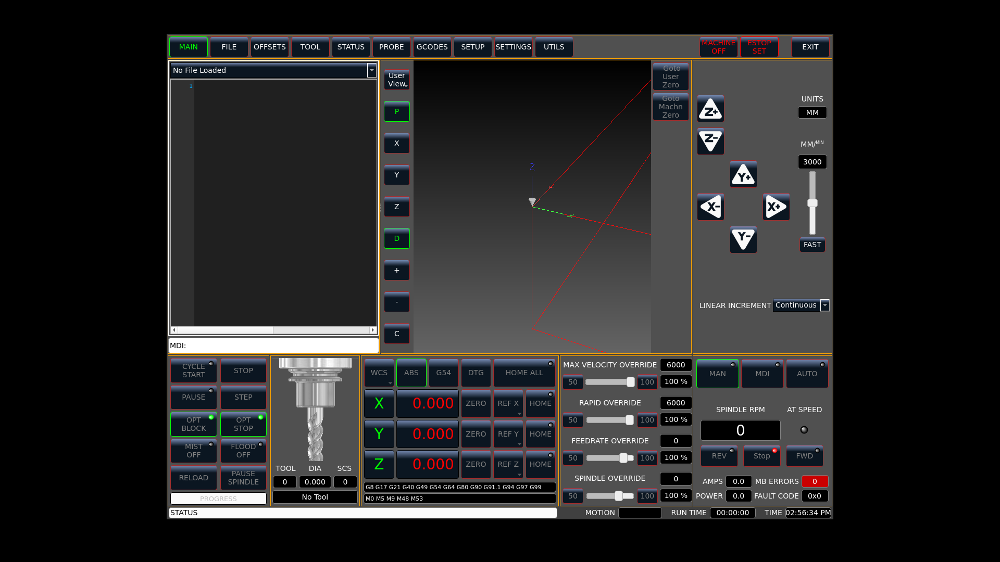

# HMI-01 — kontrakt bazowy przed przebudową nawigacji

Model-Author: Codex · 2026-10-18. Zakres: statyczna inwentaryzacja istniejącego ekranu;
bez zmiany UI, handlera upstream, akcji maszyny lub HAL.

## Materiał odniesienia

[Mapa generowana](HMI_WIDGET_MAP.md) obejmuje wszystkie 421 widgetów, rodziców,
właściwości (w tym deklaratywne akcje QtVCP), indeksy stosów, połączenia Designer,
klasy niestandardowe, odwołania `self.w`, rejestracje STATUS/Qt/klawiatury i wywołania ACTION.
Odtworzenie: `python tools/hmi_inventory.py`; kontrola: `python tools/hmi_inventory.py --check`.
SHA-256 liczone po normalizacji końców linii do LF pozwalają porównać Windows i Linux.

Zrzut bazowy z sesji 005/raportu G0 (2026-10-18), ponownie obejrzany przy HMI-01:

To istniejący zrzut, nie nowy przebieg testu. Źródło i licencja w PROVENANCE.
Pokazuje ekran bez załadowanego programu, MACHINE OFF i ESTOP SET. Nie potwierdza
widoczności wszystkich elementów przy 1280×768; zrzut ma 1920×1080, okno około 1280×933.
UI deklaruje minimum 1280×768 — odbiór tego rozmiaru pozostaje zadaniem HMI-02/06.

## Mapa migracji

| Docelowy obszar | Istniejące elementy / kontrakt |
| --- | --- |
| Stały pasek stanu | `action_estop`, `action_machine_on`, `lineEdit_statusbar`, `screen_options`; stan z STATUS oraz widgetów QtVCP |
| Start | nowy widok tylko do odczytu; nie wywołuje ACTION ani bazowania |
| Przygotowanie / Bazowanie | `btn_home_all`, `btn_home_x/y/z`, DRO; istniejące sloty i kontrola homed |
| Przygotowanie / Zero detalu | strona TAB_OFFSETS (2), PAGE_OFFSET (2), sonda TAB_PROBE (5) |
| Przygotowanie / Narzędzia | TAB_TOOL (3), PAGE_TOOL (3); tabela narzędzi i operacje pomiarowe |
| Program | TAB_FILE (1), PAGE_FILE (1), PAGE_GCODE (0), PAGE_NGCGUI (4); edytor, historia i grafika |
| Produkcja | `btn_start`, pause/stop/step i overrides; warunki `btn_start_clicked` muszą pozostać spełnione |
| Ręczne / MDI | JOG liniowy/kątowy, inkrementy, MDI, przyciski trybu; komendy tylko po świadomej akcji operatora |
| Diagnostyka / Ustawienia | TAB_STATUS (4), TAB_GCODES (7), TAB_SETUP (8), TAB_SETTINGS (9), TAB_UTILITIES (10); kamera (6), użytkownik (11) |

Nazwy z ukośnikami są skrótem grupy, nie pojedynczym objectName. Pełne nazwy w mapie.

## Zależności, które trzeba zachować

1. `initialized__` łączy `page_buttonGroup.buttonClicked` z `main_tab_changed`.
   Przyciski mają właściwość `index`, a `adjust_stacked_widgets` wybiera kombinację
   głównej strony, edytora i DRO zależnie od trybu oraz pracy interpretera.
   Nowy router nie może bezpośrednio ponumerować tych stosów według nowych ekranów.
2. `btn_start_clicked` wymaga bazowania, istniejącego pliku, AUTO i indeksu 0
   `stackedWidget_mainTab`. Przeniesienie produkcji na inny indeks bez adaptera zablokuje start.
3. `file_loaded`, ustawienia i NGCGUI także przełączają stosy. Adapter HMI powinien
   tłumaczyć prezentację w klasie pochodnej; upstream pozostaje niezmieniony.
4. QtVCP tworzy własne połączenia i piny w `_hal_init`; właściwości ActionButton/DRO
   nie są zwykłą dekoracją. Przenosić istniejącą instancję, zachować objectName,
   przypisanie joint/axis, HAL oraz jednokrotne inicjalizowanie.
5. Klawiatura przechodzi przez `processed_key_event__` i KEYBIND. Zmiana fokusu nie
   może przechwytywać edycji tekstu jako JOG; zwolnienie klawisza musi zatrzymywać JOG.
6. `screen_options` odpowiada też za dialogi, błędy i zamknięcie. Nie usuwać go wraz
   ze starym layoutem. E-STOP, alarmy i podstawowe wskazania mają pozostać widoczne.

## Granice analizy i odbiór kolejnego etapu

Mapa jest analizą XML/AST, nie emulacją QtVCP: wyrażenia `self.w[...]` pozostają jawne,
nie są wykonywane. Nie obejmuje wewnętrznych połączeń bibliotek QtVCP ani pinów tworzonych
w czasie uruchomienia. Służy do przeglądu zmian wraz z testami uruchomieniowymi.

HMI-02: zewnętrzna nawigacja prezentacyjna w handler-patch, Start/Bazowanie/Ręczne,
bez zmian upstream. Sprawdzić przejścia w ESTOP, MANUAL, MDI, AUTO idle i AUTO run;
zmiana strony nie wysyła ACTION, nie zmienia trybu, nie powoduje ruchu. Zweryfikować
powrót do produkcji, ładowanie programu, alarmy, edycję tekstu i puszczanie klawiszy JOG.
Testy QtVCP/RIP i zrzuty 1280×768 są wymagane po zmianie zachowania ekranu.

## Aktualizacja 2026-10-25

Model-Author: Claude. Inwentaryzacja z archiwalnej gałęzi (draft #130) przeniesiona na aktualny main
i odświeżona: handler zyskał grzyb E-STOP i sygnał życia (D35) oraz obejście limitów, więc zmieniły się
sumy źródeł i wpisy handlera (421 widgetów bez zmian). `tests/test_hmi_inventory.py` pilnuje, żeby mapa
zawsze zgadzała się ze źródłami; po zmianie `linumert.ui` albo handlerów uruchom `python tools/hmi_inventory.py`.
Mapa opisuje ekran bazowy QtDragon (kontrakt migracji HMI-01), nie nową powłokę HMI.
