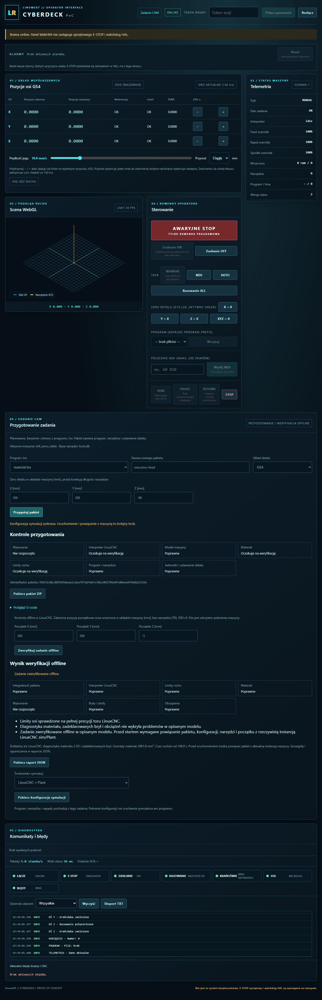

# Konfiguracja wykonawcza ze zweryfikowanego zadania

Model-Author: Codex · 2026-11-05. Pierwsza porcja poziomu3, nie odbiór wykonania.

`linumert run-config JOB --verification RAPORT.json --target sim|plant --out NOWY_KATALOG`
generuje samodzielne wejścia LinuxCNC i Plant z tego samego zweryfikowanego pakietu.
API/WebHMI pozwala pobrać ich ZIP po dodatnim verify. Nie uruchamia procesów, nie łączy
CNC, nie resetuje E-STOP/STO i nie zezwala na ruch. Werdykt offline nie jest autoryzacją
wykonania; manifest konfiguracji ma status configured i execution_authorization=false.

## Wiązanie danych

Raport weryfikacji ma poprawny digest, właściwy job_id, verified oraz wszystkie wymagane
kontrole passed. Założony początek/T0/G92=0 i ustawienie detalu są zachowane, nie udawane
jako odczyt kontrolera. API odczytuje wyłącznie raport zapisany przez skonfigurowaną bramę,
pod podanym identyfikatorem; klient nie przesyła własnego raportu ani ścieżki pliku.

Każdy napęd otrzymuje własną pochodną zamrożonego szablonu. Zmienia się wyłącznie jego
techniczne id w osobnej bibliotece drive_library; wszystkie parametry pozostają identyczne
z drives.json. Nie czytamy bieżącej biblioteki ani nowych wartości domyślnych. Ten sam
rachunek counts_per_unit zasila LinuxCNC i model Plant. Pełny oryginalny pakiet pozostaje
w job/, raport w verification.json; tabela tool.tbl i program są identyczne bajtowo.
Plik parametrów inicjalizuje zapisany układ detalu i wyzerowany G92.

execution.json wiąże wszystkie zasoby SHA-256, job_id, verification_id, skale i mapę
pochodnych szablonów. Odczyt sprawdza także ponowne wygenerowanie całości: samo podpisanie
nowego hasha ręcznie zmienionego HAL nie wystarcza. Publikacja nowego katalogu jest atomowa
i odmawia nadpisania istniejącego. Ścieżki zasobów nie mogą wychodzić poza pakiet.

Eksport obsługuje wyłącznie sim/Plant, lokalne połączenie Plant i domyślnie zachowuje
HMI_ESTOP_BYPASS=0. CLI wymaga jawnego --test-mode dla testowego bypassu; API nie przyjmuje
tego pola. Oryginalny model jest zachowany, pochodny cel symulacyjny nie ma konfiguracji
połączenia sprzętowego. Nie jest to zmiana zasad bezpieczeństwa.

## Odbiór porcji

37 testów eksportu/werdyktu/architektury/konfiguracji PASS; następnie65 regresji CLI,
przygotowania i API PASS (zakresy częściowo wspólne). ZIP API zgodny z backendem, token/Host
i pola payloadu sprawdzone, brak zmiany stanu fake CNC i oryginalnego pakietu.
Dwa rzeczywiste testy rs274 PASS: sim i Plant konsumują wyeksportowane narzędzia/parametry/
INI/remap i odtwarzają ten sam zweryfikowany tor. To test interpretera offline, nie start
kontrolera ani wykonanie programu w Plant. Lint całego drzewa PASS.

Próba publicznym loaderem Plant wykryła zapis małych liczb JSON typu3e-05 jako tekst YAML1.1.
Poprawka68c6362 zapisuje szablony przez safe_dump, zachowując liczby i wszystkie parametry.
Testy korzystają teraz z publicznego load_machine_drives, nie z json.loads jako zastępstwa
loadera. Po poprawce17 testów eksportu PASS, w tym G55 już w startup code i pliku parametrów;
dodatkowy rzeczywisty test rs274 G55 PASS. Nie przełącza początku konfiguracji na domyślny G54.

Kliknięty odbiór WebHMI na własnej bramie fake8791: prepare → verify → pobranie konfiguracji
LinuxCNC + Plant. Poprawiony `execution-fixed-plant.zip` zawiera26 zasobów identycznych
bajtowo z rzeczywistym CLI run-config. Publiczny loader i rdzeń C Plant budują maszynę
z faktycznie pobranego ZIP (`machine build ... --dir drive_library --run` PASS).
To nadal budowa wirtualnego modelu, nie uruchomienie LinuxCNC lub programu.

Job_id `95bf2c0bc88fb59abaa1cdea747ddfdbfc58bc042701d4fe0beed5fbb8a1316e`;
verification_id `f6bf9edd09bca992b4713a73b2293fb6d37d8b1259ac726d6d3a4b3cacacb26f`;
execution_id `a034404861204810262976262f99f451a01316e2520235222a83f8c84c894328`.
Źródło odbioru68c6362; zmiana startup G55 nie zmienia tych zasobów G54.
Brama8791 zatrzymana po sprawdzeniu PID/modułu/portu/cwd. Nie uruchamiano kontrolera
i nie zajmowano współdzielonej blokady LinuxCNC.

Pełny natywny klon6058529:2126 PASS,15 skip,240 linuxcnc deselected,184 subtesty PASS;
1 znana porażka starego Qt cleanText100/85, odtworzona wcześniej na main.
Nie deklarujemy całej lokalnej regresji bez porażek. W tym klonie make lint test-c i REQ22/22
PASS; początkowy brak wygenerowanego prompts/README.md został poprawiony przez6058529.
Późniejszy serializer/G55 sprawdzono17 testami zakresu, rzeczywistym G55 i publicznym Plant C.
Końcowe CI i scalenie porcji pozostają wymagane.

Dalszy poziom3: prywatna robocza kopia konfiguracji (LinuxCNC zapisuje .var/logi), start
instancji, sprawdzenie jej konfiguracji/tabeli/początku/T0 i istniejących blokad gotowości,
następnie jawny Start oraz telemetria, pauza/wznowienie/Stop/awarie. Kontrola eksportu nie
udaje wykonania tych kroków. Poziom4 — raport porównawczy — pozostaje otwarty.
NIEZWERYFIKOWANE NA SPRZĘCIE.
