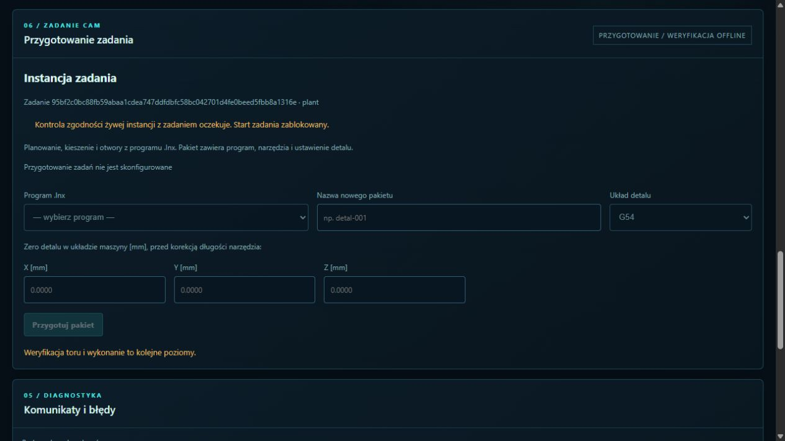

# Prywatna instancja zweryfikowanego zadania

Model-Author: Codex · 2026-11-05. Porcja VERTICAL-RUN, sesje028/029/049/053/061.

`linumert-job-instance KONFIGURACJA --out NOWY_KATALOG --port 8765` tworzy prywatne
`evidence/`, `config/` i `home/`, następnie uruchamia własne procesy Plant i LinuxCNC.
Dowody pozostają niezmienne. LinuxCNC korzysta z odrębnych parametrów, tabeli i HOME.
DISPLAY uruchamia WebHMI z istniejącymi pinami HAL i łańcuchem watchdog/HMI, bez bypassu.
Instancja test-mode i aktywny wcześniejszy LinuxCNC są odrzucane; brak globalnego cleanup.
Po przerwaniu kończymy wyłącznie własne grupy procesów. Logi pozostają w katalogu instancji.

WebHMI pokazuje zadanie i cel. Start/wznowienie są zablokowane w bramie oraz kliencie,
ponieważ kontrola żywego początku, narzędzi i konfiguracji nie jest jeszcze wdrożona.
Stan `instance_loaded` nie jest wynikiem wykonania ani zgodą na ruch. Nie wykonujemy
Reset/ON/bazowania. Istniejące jawne sterowanie operatora pozostaje dostępne zgodnie
z jego blokadami. Odbiór rozruchu i GUI, końcowe CI oraz scalenie tej porcji wymagane.

Pierwsze35 testów instancji/bramy/architektury PASS;41 JS PASS. Fixture raportu w testach
jednostkowych jest skonstruowana; nie udaje wyniku rzeczywistego interpretera.
Potrzebny dalszy etap: kontrola żywego stanu przed Start, wykonanie i trwała telemetria,
przerwania oraz raport poziomu4. NIEZWERYFIKOWANE NA SPRZĘCIE.

## Rzeczywisty rozruch i odbiór WebHMI

Test `test_job_instance_linuxcnc.py` PASS: rzeczywisty LinuxCNC2.9 RIP i Plant z zamrożonej
konfiguracji, DISPLAY WebHMI/HAL, stan E-STOP, osie niezbazowane, odmowa HTTP409 dla Start,
niezmienny oryginalny plik parametrów, brak procesów LinuxCNC po zakończeniu hosta jeszcze
przed cleanupem fixture. Użyty token zaczyna się od `--`, aby sprawdzić cały łańcuch argumentów.
Jednostkowo37 testów instancji/bramy/architektury PASS; regresja117 PASS/4 Node-WSL skip
przed ostatnią poprawką zamykania.41 JS PASS. Zakresy zachodzą na siebie.

Rozruch ujawnił i naprawił: zapis prywatnego .var przed DISPLAY, limit108 bajtów nazwy
gniazda RTAPI oraz argument tokenu zaczynający się od myślnika. HOME jest trwale prywatny,
a krótki tymczasowy alias pozwala działać również z długą ścieżką instancji. Parametry live
nie są dowodem zgodności początku; Start nadal zamknięty. Zamykanie najpierw kończy własny
DISPLAY, następnie procesy hosta i wyłącznie daemony z odziedziczonym znacznikiem tej instancji.
Pidfd chroni przed ponownym użyciem PID. Osobny test potwierdza zachowanie obcego procesu.

Kliknięte WebHMI8792 użyło rzeczywiście odebranego `execution-fixed-plant.zip` z #227,
nie fixture raportu jednostkowego. LinuxCNC + Plant działały w prywatnym katalogu,
brama miała aktywne HAL, E-STOP bez Reset/ON/bazowania. Operator połączył ekran i otworzył
„Zadanie CAM”: widoczny właściwy job_id, cel Plant i przyczyna zamknięcia Start.

Surowy odczyt NML/WebHMI: `vertical/instance-boot-20261105.json`. Nie jest zapisem
wykonanego programu. Job95bf2c0bc88fb59abaa1cdea747ddfdbfc58bc042701d4fe0beed5fbb8a1316e,
executiona034404861204810262976262f99f451a01316e2520235222a83f8c84c894328.
Po odbiorze własny host i moduły zakończone/przywrócone; inwentaryzacja bez procesów,
wspólny lease LinuxCNC zwolniony. Końcowa regresja/CI i scalenie nadal wymagane.
