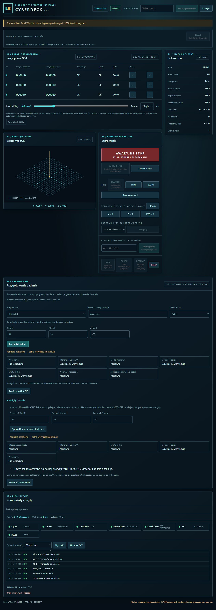

# Dokładny tor i limity w pełnym WebHMI

2026-11-05 · Model-Author: Codex. Autokontrola, bez niezależnego przeglądu.
Pierwsza porcja #223 nad C #222, w ramach VERTICAL-VERIFY (044/049/051/052/055).
Przygotowanie i częściowy preflight #221 są już w main (353a472).

## Odbiór operatora

Własna brama `--fake` na 8788, WSL Debian 12, rzeczywiste rs274 i gcode z budowy
`/home/codex/.cache/linuxcnc-2.9`. Opcjonalny adapter C++ zbudowany z tego SDK.
Brak kontrolera LinuxCNC/Plant, NML/HAL i fizycznego ruchu.

Kliknięto prepare `precise-ui`, a następnie kontrolę, dla danych tests/job_support.py:
G54 (50,50,-80) mm; założony początek nosa (50,50,-5), T0/G49/G92=0.
WebHMI pokazuje integralność/interpreter/limity poprawne, materiał/kolizje oczekujące
i wykonanie nierozpoczęte. Całość pozostaje partial, nie verified.

Pobrany precise-ui-preflight.json jest identyczny z utrwalonym JSON bramy:
report_id `77cac16ff8f8507c0ebdc185a92f26f758e48ef900175e75c40228c9094abf48`.
Rzeczywisty CLI uruchomiony na tym samym pakiecie daje identyczny cały wynik
po wyłączeniu elapsed_seconds i wyliczanego z niego report_id. Tor ma 82 ruchy;
job_id `6f7086f6d990b4c5e69398e2e8df5e47ee27326fdd5d1fd9c54c2e759bea9c67`.
Brama odbioru zatrzymana po zapisaniu dowodów.

## Testy i granice

- 16 rzeczywistych testów RIP PASS: 12 dokładnego toru oraz 4 jawnego trybu
  zaokrąglonego preflight. G54/G55, oryginalne linie/T/RPM, cale bez podwójnego
  skalowania korekcji, wykonywane warunkowo T1/T7 i wyrażenie T#1.
- Granica: X=599,00004 mm przy limicie599 mm odrzucone (linia20), mimo że tekst
  rs274 zaokrągla do599,0000; X=598,99996 poprawne. Wnętrze łuku schodzące do
  X=0,5 przy dolnym limicie1 mm wykryte, choć końce mieszczą się w zakresie.
- EOF, pętla, brak dodatniego posuwu, niezgodne oba interfejsy i niepełny/niekołowy
  łuk nie dają PASS. Istniejąca lub nieprywatna .tool.mmap nie jest otwierana/truncowana.
- 170 testów pakietów/CLI/API/limitów/architektury/WebHMI PASS, 7 subtestów PASS;
  4 skip Node w WSL (40 JS sprawdzonych osobno na Windows). Pełny lint PASS.
- API utrwala dokładny wynik, zachowując dziewięć plików i ZIP przygotowania;
  stan CNC atrapy bez zmian. Warunki startu są założeniami, nie pomiarem z CNC.

SDK jest opcjonalne i wymaga zgodnej budowy RIP. Brak pełnej precyzji oznacza
limity pending, nie zastępczy PASS. Po zgodnym rs274 i callbackach limity XYZ mogą
mieć PASS, ale **materiał/kolizje/obciążenia oraz cały VERTICAL-VERIFY są otwarte**.
Wykonanie/telemetria i raport porównawczy także pozostają do odbioru.
Końcowe CI i scalenie wymagane. NIEZWERYFIKOWANE NA SPRZĘCIE.
