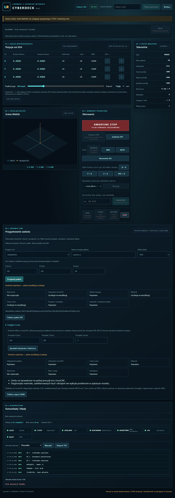

# Diagnostyka materiału przygotowanego zadania

Model-Author: Codex · 2026-11-05. Autokontrola, bez niezależnego przeglądu.
Pełny projekt linumeRT, WebHMI i wspólny backend; bez osobnej edycji lite.

## Zakres pierwszej porcji

Po integralności pakietu, ponownej kompilacji, rs274 i uzgodnieniu dokładnych callbacków
uruchamiany jest osobny proces diagnostyki z nice co najmniej10. Nie odczytuje kontrolera,
nie otwiera NML/HAL, nie zmienia E-STOP, STO, enable ani heartbeat. CLI i API używają
tej samej kompozycji; rdzeń nie importuje symulacji. Wynik nadal jest częściowy.

- Tor float64/mm z wykonanych callbacków LinuxCNC, bez parsera podzbioru i MoveList float32.
  G5x/G92/obrót/TLO zachowują fizyczną pozycję nosa. Syntetyczne N0 ustala początek,
  nie tworzy przejazdu przez materiał. TCP = nos minus rzeczywista długość wybranego T.
- Maszyna z zamrożonych machine.yaml i drives.json. Bez odczytu aktualnej biblioteki
  szablonów, domyślnej siły osi i zastępczej mocy wrzeciona. Strefy zakazane są przeszkodami.
- Profile flat/drill_118 wymagają jawnych wymiarów ostrza i oprawki, spójnej długości Z,
  kierunku, liczby ostrzy i maksimum RPM. Braki dają wynik niepełny, nie zastępczy walec.
- Materiał 2.5D: komórka0,25mm (z ograniczeniem liczby komórek), próbki co najwyżej0,25mm
  i0,05s, błąd cięciwy łuku co najwyżej0,005mm. Same współrzędne toru pozostają double.
  Siatka materiału jest przybliżeniem diagnostycznym, nie odbiorem dokładności pozycjonowania.
- Ciągłe konserwatywne obwiednie przejazdów przeciw zadeklarowanym bryłom obejmują także
  cienką przeszkodę między próbkami. Prostokątna obwiednia walca może dawać fałszywy kontakt
  przy narożu. Łuki mają dodatkowe powiększenie obwiedni o błąd cięciwy.
- Reguły materiału, części nietnących i obciążeń korzystają z istniejącego SimEngine;
  stan na początku odcinka zachowuje nowy G0/G1 oraz RPM, bez dziedziczenia poprzedniego M3.

## Odbiór wykonanej porcji

Runtime9b8db72 (#224): CI42068160782 i LinuxCNC42068160574 success.
Scalony do main jako `c0b42c41c197b08cca4eca5053021b084f60e2c4`.
19 rzeczywistych testów RIP PASS:16 poprzedniej porcji oraz3 materiału (pełny detal
face/pocket/drill w faktycznych Python/C, brak geometrii i imadło K-304 z linią).
65 regresji PASS; lint całego drzewa PASS. Osobny commit dowodów dodaje2 testy odbioru:
API/CLI/utrwalanie bez zmiany CNC oraz rzeczywistą kieszeń okrągłą z wejściem helikalnym
(4 dotychczasowe przypadki materiału oraz1 łukowy PASS). Nie zmienia kodu runtime.

Pełny natywny klon9b8db72:2097 PASS,15 skip,232 linuxcnc deselected,184 subtesty PASS,
jedna znana porażka starego Qt (`cleanText`100/85), odtworzona wcześniej na main.
Nie jest to deklaracja całej lokalnej regresji bez porażek. `make lint test-c` PASS:
Plant C,7 core/native C i192 Python z C,6 subtestów; REQ22/22 PASS.
Wheel zainstalowany poza checkoutem PASS, także pełny rzeczywisty rs274 → SDK → materiał C
→ raport przez CLI z importami z katalogu instalacji i nice10.40 testów JS oraz syntax PASS.

Kliknięty odbiór WebHMI: własna brama fake8789, rzeczywisty rs274 i SDK LinuxCNC oraz
worker materiału z backendem C i nice10. Przygotowanie i kontrola detalu z dwoma T;
wszystkie kontrole diagnostyczne passed, wykonanie not_started, całość partial.
81 realnych ruchów,4981 próbek, długość1178,634381mm, usunięte2861,832031mm³,
dolny czas ruchów107,958839s. Maksimum mocy56W, moment0,08912677Nm, siły29,70892271N.

Pobrano `material-ui-preflight.json`: identyczny z raportem utrwalonym przez bramę.
Cały wynik rzeczywistego CLI identyczny z GUI poza elapsed_seconds i report_id.
Pakiet job_id `95bf2c0bc88fb59abaa1cdea747ddfdbfc58bc042701d4fe0beed5fbb8a1316e`;
raport GUI `1a9dcf519d53ede2127ef5df0f9f37400e1cc707a51b72b4e13608cbfae5a646`.
Stan fake pozostał bez ruchu, narzędzie0, interpreter idle; przygotowanie/diagnostyka
nie wysłały komendy CNC. Zrzut przedstawia odbiór runtime9b8db72.

## Pomiar całego przepływu Python/C

Rzeczywisty CLI (`python -m linumert.cli preflight`), start procesu, odczyt/weryfikacja
pakietu i ponowna kompilacja, rs274, dokładny SDK, worker materiału i zapis raportu.
Po jednym rozgrzaniu obu backendów:3 mierzone powtórzenia, naprzemiennie Python/C.

| Backend | Minimum całego wywołania | Mediana |
|---|---:|---:|
| Python | 7,1732s | 7,2761s |
| C | 4,0744s | 4,2322s |

Mediana około1,72× szybciej dla tego jednego detalu. Oba backendy dają identyczną
objętość, zdarzenia, czas modelowy, liczbę ruchów/próbek i maksima obciążeń.
Surowe pomiary: [JSON](vertical/material-benchmark-20261105.json).
WSL2/Debian12/Python3.11, źródła na /mnt/c, bez izolacji CPU; własna brama fake bez ruchu
pozostała uruchomiona. Nie jest to gwarancja wydajności sprzętu ani toru czasu rzeczywistego.
Stary pomiar subset z #222 pozostaje odrębnym pomiarem innego przepływu.

Wynik zawiera objętość usuniętą, dolne oszacowanie czasu ruchów, maksima obciążeń,
zdarzenia K-3xx z linią/T/pozycją, zakres brył i rozdzielczości oraz wybrany backend.
Raport jest osobnym niezmiennym plikiem, powiązanym job_id; pakiet pozostaje bez zmian.
Błąd/timeout/urwany JSON procesu nie daje dodatniej diagnostyki.

## Ograniczenia i pozostały odbiór

Nie odgadujemy mocowań i wymiarów czujników z samej pozycji punktowej. Model obejmuje
zadeklarowane bryły i strefy; ręczne ruchy operatora podczas zmiany narzędzia nie są
ruchem interpretera. Nieobsługiwany profil, postój DWELL lub niepełny model daje wynik
niepełny. Czas nie obejmuje przyspieszeń, wygładzania, zwłok i ręcznej zmiany narzędzia.
Materiał i siły są modelem diagnostycznym, nie funkcją bezpieczeństwa.

Brama fake8789 została zatrzymana po sprawdzeniu PID/modułu/portu/cwd; brak własnego
działającego kontrolera LinuxCNC i brak blokady wspólnych zasobów po tym odbiorze.
Formalny status verified i powiązanie początku/T0 z wykonaniem oraz poziomy3–4
pozostają osobne; obecna porcja uczciwie zachowuje partial.
NIEZWERYFIKOWANE NA SPRZĘCIE.
