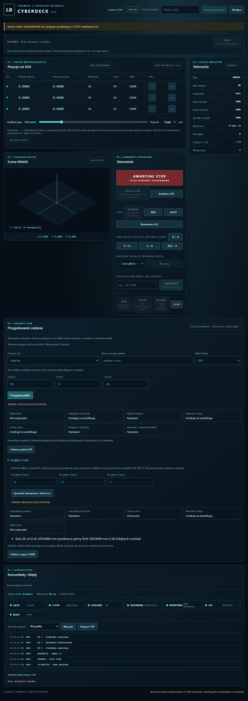

# Częściowa kontrola pakietu w pełnym WebHMI

2026-11-05 · Model-Author: Codex. Autokontrola, bez niezależnego przeglądu.
Zakres: pierwsza porcja VERTICAL-VERIFY (044/049/051/052/055), PR #221.
Prepare i wspólne napędy są w main przez #217/#219/#220.

## Odbiór operatora

Własna brama `--fake` na 8787, WSL Debian 12; **interpreter rzeczywisty**:
`/home/codex/.cache/linuxcnc-2.9/bin/rs274`, uruchamiany z prywatnym stanem.
Nie uruchamiano kontrolera LinuxCNC ani Plant i nie wykonywano fizycznego ruchu.
Program/narzędzia: `tests/job_support.py`, G54 (50,50,-80) mm, początek nosa
wrzeciona (50,50,-5) mm, T0/G49/G92=0. To założenia, nie pomiar z maszyny.

Kliknięte w przeglądarce aplikacji:

1. Połączenie, wybór detal.lnx, prepare `preflight-ui`.
2. Wpisanie pozycji początkowej, „Sprawdź interpreter i ślad toru”.
   Integralność i interpreter poprawne; wynik częściowy, limity/materiał oczekują.
3. Pobranie `preflight-ui-preflight.json`. Porównanie z zapisanym raportem bramy:
   identyczny JSON; report_id `2168c500e6c42efd7f1d42ff6e8ff05c930e971f2fa6a21dc9ee2a777978c207`.
   job_id `6f7086f6d990b4c5e69398e2e8df5e47ee27326fdd5d1fd9c54c2e759bea9c67`.
4. Nowy pakiet `preflight-ui-limit`, zero X=590 mm. Interpreter kończy program,
   kontrola odrzuca: linia 20, X=650,0000 mm > 599,0000 mm (i 66 kolejnych punktów).
   Materiał nadal oczekuje, wykonanie nierozpoczęte. STOP/Reset/zezwolenia bez zmian.

## Testy i ograniczenia

- 131 testów pakietu, CLI/API, klasyfikacji wyniku i limitów PASS; 7 subtestów PASS.
- 4 rzeczywiste przebiegi rs274 PASS: G54, G55, przesunięcie poza X, zmieniona długość
  T1 z tabeli powodująca przekroczenie Z. Oryginały i sentinel live HOME/.tool.mmap zachowane.
- 40 dotychczasowych testów JS PASS; lint całego drzewa PASS.
- Dodatkowa regresja aplikacji/statycznego klienta/raportów/limitów: 106 PASS,
  4 skip (Node niedostępny w tym venv WSL; 40 JS uruchomiono na Windows).
  Wheel poza checkoutem PASS, w tym brak interpretera i zachowanie pakietu; REQ 22/22 PASS.
- Przypadki bez interpretera, timeoutu, limitu danych, błędu po PROGRAM_END i pozornego
  PROGRAM_END w komentarzu nie dają pozytywnej kontroli. Zmiana SHA-256, ponownie
  podpisany obcy G-code, niezgodny job_id i zmiana podczas kontroli są odrzucane.
- Raport zapisuje się osobno, bez nadpisania. API wymaga dotychczasowych Host/token;
  kontrola działa w wątku roboczym, nie emituje komend CNC. ZIP przygotowania bez zmian.

Tekstowy ślad LinuxCNC ma cztery miejsca w jednostkach programu. Dlatego **nigdy nie
nadajemy verified ani PASS pełnym limitom**. Pełna precyzja, materiał/kolizje/obciążenia,
pomiar Python/C oraz wykonanie/telemetria/raport porównawczy pozostają otwarte.
Nie użyto fallbacku parsera podzbioru. Odbiór symulacji nie kwalifikuje sprzętu.
Końcowe CI oraz scalenie tej porcji pozostają wymagane.
Własna brama odbioru na 8787 zatrzymana po teście.
