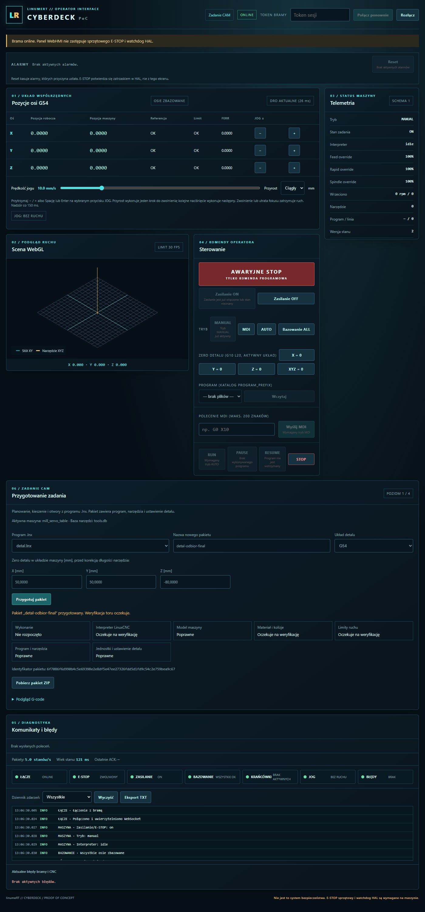

# Przygotowanie zadania w pełnym WebHMI

2026-11-05 · Model-Author: Codex. Autokontrola; bez niezależnego przeglądu.

Zakres: VERTICAL-PREPARE, pierwotne sesje 032/039/040/041/043/062.
Pierwsza porcja: jedna aktywna maszyna i baza narzędzi skonfigurowane przy starcie bramy,
wybór programu `.lnx`, układu G54–G59 i zera detalu, przygotowanie oraz eksport ZIP.
Generatory: header, tool_change, face_mill, pocket_rect, pocket_circle, drill_holes, program_end.
Pozostałe funkcje CAM pełnego projektu zachowują dotychczasowe działanie.

## Odbiór przez ekran

Własna brama `--fake` na porcie 8786, WSL Debian 12, klient przeglądarkowy aplikacji
na Windows. Dane z `tests/job_support.py`: planowanie, kieszeń v2, dwa otwory i dwa narzędzia,
`mill_servo_table.yaml`, G54, zero detalu (50, 50, -80) mm przed korekcją długości.

Kliknięte i zaobserwowane:

1. Połączenie tokenem, wejście przez „Zadanie CAM”, odczyt aktywnej maszyny i bazy.
2. Wybór `detal.lnx`, nowej nazwy oraz współrzędnych, „Przygotuj pakiet”.
   Wynik: „Pakiet «detal-odbior» przygotowany. Weryfikacja toru oczekuje”.
3. Raport: model/program/narzędzia/ustawienie poprawne; interpreter, limity i materiał
   oczekują; wykonanie nierozpoczęte. Działający podgląd i pobieranie ZIP.
4. ZIP zapisany przez przeglądarkę jako `detal-odbior.zip` (9 zasobów).
5. Ponowna publikacja: „Pakiet już istnieje: detal-odbior”.
6. G55 przy nagłówku G54: „krok 1: jednostki lub układ nagłówka nie odpowiadają zadaniu”.
7. Przywrócenie G54 i nowej nazwy `detal-odbior-final`: poprawny pakiet o tym samym ID
   `6f7086f6d990b4c5e69398e2e8df5e47ee27326fdd5d1fd9c54c2e759bea9c67`.

To odbiór przygotowania na atrapie, nie dowód wykonania LinuxCNC/Plant ani kwalifikacji sprzętu.

## Testy i granice

14 testów rdzenia pakietu i 12 testów CLI/API PASS: deterministyczność, identyczne bajty
źródła (także CRLF), zachowanie bazy i historii, odmowy danych/ścieżek/zmiany zasobów,
publikacja bez nadpisania również przy wyścigu i awarii. Test porównuje stan maszyny
przed i po przygotowaniu. Regresja aplikacji i zasobów WebHMI: 35 PASS, 4 pominięte
bez Node w WSL; osobno 40 testów JS na Node Windows PASS oraz kontrola składni modułów.

Wheel zbudowany standardowo przez `pip wheel . --no-deps`; rozpakowany i uruchomiony
poza checkoutem, z `python -S`, bez importu pakietu edytowalnego. Entry point CLI,
zasoby widoku i przygotowanie pakietu z jawną biblioteką napędów PASS; identyczne ID.

Pakiet jest `prepared`, nie `verified`. Model i napędy są rozwiązywane wspólną logiką
Plant; nie interpretujemy toru własnym uproszczonym parserem. Interpreter, granice
ruchu, materiał i kolizje należą do VERTICAL-VERIFY. Wybór wielu konfiguracji maszyny
i baz narzędzi z GUI pozostaje poza tą pierwszą porcją. NIEZWERYFIKOWANE NA SPRZĘCIE.
