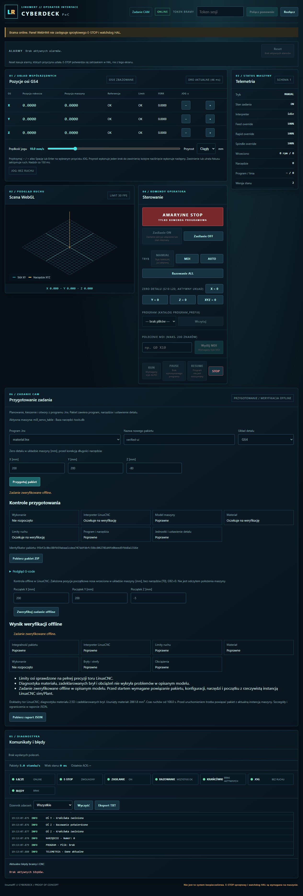

# Werdykt weryfikacji offline

Model-Author: Codex · 2026-11-05. Autokontrola, bez niezależnego przeglądu.

`linumert verify JOB --start X Y Z --out NOWY.json` i endpoint `/api/jobs/NAME/verify`
uruchamiają tę samą rzeczywistą kontrolę co preflight, bez promowania starego raportu
lub wyniku otrzymanego od klienta. Wynik `linumert.job.verification`v1 ma status verified
wyłącznie po dodatnich kontrolach integralności, interpretera, dokładnych limitów,
materiału, zadeklarowanych brył/stref i obciążeń. Nowa/pending/niepełna kontrola nie daje
verified. Brak SDK, geometrii, materiału, błąd lub timeout nadal dają wynik ujemny/niepełny.

Weryfikacja dotyczy obsługiwanego modelu diagnostycznego z opisanymi ograniczeniami.
Zachowuje założony początek nosa/T0/G92=0 i wszystkie ograniczenia raportu materiału.
`verification.execution_authorization` jest zawsze false; `execution` pozostaje
not_started. Przed startem trzeba powiązać pakiet, konfigurację, narzędzia i pozycję
z rzeczywistą instancją LinuxCNC sim/Plant. Samo verify nie odczytuje ani nie steruje CNC.
CLI preflight i dotychczasowy endpoint pozostają diagnostyką ze statusem partial.

WebHMI wywołuje verify istniejącym formularzem, z przyciskiem „Zweryfikuj zadanie offline”.
Kontrole przygotowania i wynik weryfikacji mają osobne nagłówki. Pozytywny wynik ma
czytelny komunikat o wymaganym związaniu z maszyną; nie uruchamia programu.

Pierwszy checkpoint:12 testów bramek werdyktu; regresja rdzenia/CLI/API i statycznego
WebHMI PASS (4 testy wymagające Node pominięte w WSL). Trzy rzeczywiste RIP: kompletne
zadanie verified, brak oprawki incomplete, przekroczone limity rejected. Rzeczywisty
CLI/API verified i utrwalanie identycznego raportu bez zmiany pakietu lub CNC PASS.
GUI odebrane na własnej bramie fake8790 z rzeczywistymi rs274/SDK/materiałem C,
runtime ebca978 (5beb4be dodaje wyłącznie brakujący wpis pochodzenia obrazu #225).
Kliknięte prepare i verify; wszystkie kontrole passed, status verified, wykonanie
not_started i execution_authorization=false. Narzędzie0, interpreter idle, brak komend CNC.
Zrzut bez retuszu, wpis pochodzenia w PROVENANCE.md:

Cały wynik rzeczywistego CLI verify identyczny z zapisem WebHMI poza elapsed_seconds/report_id.
Job_id `95bf2c0bc88fb59abaa1cdea747ddfdbfc58bc042701d4fe0beed5fbb8a1316e`;
raport GUI `b701bac7072220a16d77b064a413871702240e25280981caf06e67e3871a903d`,
CLI `daec6a8d76eea56c7d243ece8b022327bb0817e3019f796d259d19af8cd38bdf`.
Brama8790 zatrzymana po sprawdzeniu PID/modułu/portu/cwd. Brak własnego działającego
kontrolera LinuxCNC i brak zajętej blokady wspólnych zasobów.

Pełna regresja natywna i końcowe CI/scalenie w toku. Pierwszy CI dowodów #225 wykrył brak
wpisu zrzutu materiału w PROVENANCE; poprawka821971e jest zawarta w tej gałęzi. Wskazany
test zasobów lokalnie PASS; cała kontrola IP lokalnie9 PASS/1 FAIL wyłącznie z powodu
ignorowanego binarnego artefaktu ASan w build-san (poza Git); czysty klon nie ma tego pliku.
Nie jest to powód omijania CI. NIEZWERYFIKOWANE NA SPRZĘCIE.

Aktualizacja2026-11-07, Model-Author: Codex: całość zawarta w #227, scalonym do main63254c9
po końcowym ci42090379375 i LinuxCNC42090379317 success dla dokładnego edcacf3.
Następny maincd8ed66 (#228) dodaje odebrany prywatny rozruch; jego head211160e ma2134
lokalne testy i końcowy Python/LinuxCNC success. Weryfikacja offline odebrana; powiązanie
przed Start i poziomy3–4 pozostają odrębnym niezakończonym zakresem.
