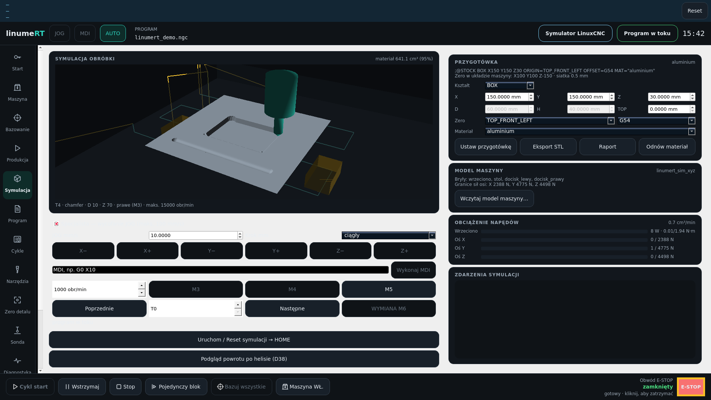
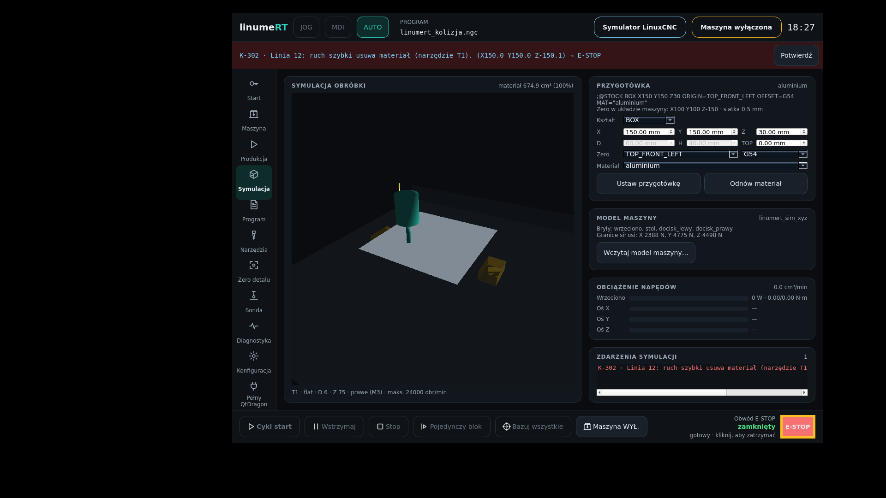

# Bieżące zrzuty HMI i podglądu skórek

Model-Author: Codex · 2026-10-23. Kod ekranu: main `8483b81` (PR #89).
Obrazy są zrzutami uruchomionych aplikacji, bez montażu grafik koncepcyjnych.

## Cztery osobne ekrany skórek — offline

Kod ekranów: `ea2fc39`, 2026-10-23. Osobne moduły i klasy: Classic Digital,
Industrial Pro, Cyberdeck, Organic Vector. Każdy ma własną kompozycję paneli,
konsolę i geometrię kontrolek. Wspólne są komponenty odczytu, palety i renderer.
Zrzuty 1920×1080 / English, wykonane bez retuszu przez `tools/dev/skin-check.py`.
Classic/Organic: Classic Turquoise; Industrial: Reactor Green; Cyberdeck: Ion Blue.
Skórka, paleta i język pozostają niezależnymi ustawieniami.

| Classic Digital | Industrial Pro |
|:--|:--|
|  |  |
| Cyberdeck | Organic Vector |
|  |  |

Uruchamiaj wybrany ekran osobno (PyQt5, pyqtgraph, PyOpenGL):

```sh
python3 tools/dev/skin-preview.py --skin classic-digital
python3 tools/dev/skin-preview.py --skin industrial-pro --theme reactor-green
python3 tools/dev/skin-preview.py --skin cyberdeck --theme ion-blue
python3 tools/dev/skin-preview.py --skin organic-vector
```

Bez `--skin` launcher pokazuje także selektory do porównań; w osobnym ekranie
wybory są dostępne w **Ustawienia**. Nawigacja powiększa panele programu, maszyny
lub narzędzi. Diagnostyka pokazuje dane lokalnego renderera lub panel odczytu.
Przyciski cyklu/JOG i przełączniki nie wysyłają poleceń CNC; dane są nieznane.
Grzyb jest **nieinteraktywnym wskaźnikiem nieznanego stanu E-STOP**. To osobny
host offline, nie zastępuje działającego HMI ani jego łańcucha bezpieczeństwa.
Modele maszyny i materiału nadal są poglądowe.

Odtworzenie galerii i odbioru na X11/Xwayland:

```sh
python3 tools/dev/skin-check.py --output build/skin-docs
```

Pliki `*-1920-standalone.png` to powyższa galeria. Odbiór obejmuje **128 wariantów**:
4 skórki × 4 palety × 2 języki × 2 rozmiary × browser/standalone. Sprawdza obrazy
GL, 24-bitową głębię, rozmiary, powiększanie i globalne kontrolki. Wzorce:
[oryginalne grafiki właściciela](../../design/referencje-skin/README.md).
Pełna zgodność wszystkich szczegółów grafiki, modele zamiast schematu oraz
integracja stanu i poleceń QtVCP pozostają dalszym etapem.

## Symulacja obróbki — aktualny ekran operatora

Nowe ujęcia z 2026-10-23, Debian 12/LinuxCNC 2.9.10, osobny kontener i Xvfb,
okno 1920×1080. UI z main `8483b81`; program demonstracyjny po poprawce komentarza
`8675777`. Bez montażu, retuszu lub zastępowania widoku bitmapą wzorcową.

| Przebieg | Zrzut |
|:--|:--|
| Obróbka w toku |  |
| Po całym programie, łącznie z ostatnim narzędziem T11 |  |
| Diagnostyka K-302, bez odebrania stanu ON przez symulację |  |

[Wynik przebiegu w JSON](wynik-2026-10-23.json) potwierdza bazowanie, działanie
procesu symulacji, ukończenie demo bez kolizji, ubytek materiału i oczekiwane K-302.
Końcowe narzędzie T11 oraz bezczynny interpreter są warunkiem zaliczenia demo.
Podczas odświeżania wykryto zagnieżdżony komentarz przy operacji M4: poprzedni
skrypt błędnie zaliczał przedwcześnie przerwany program. Poprawiono komentarz,
wzmocniono kontrolę ukończenia i dodano test leksera dla obu dostarczonych programów.

Odtworzenie:

```sh
tools/dev/sim-e2e.sh
```

Wyniki i kolejne klatki: `build/sim-e2e/`. Do galerii wybrano ujęcie podczas
programu, `02_po_demo.png` i `03_kolizja.png`; okno rozciągnięto do 1920×1080.
Konfiguracja testowa jest kopiowana do `/tmp` wewnątrz kontenera i używa
`HMI_ESTOP_BYPASS=1` wyłącznie dla automatycznej próby bez operatora; konfiguracja
operatora pozostaje bez zmian. Test nie korzysta z fizycznej obrabiarki.

NIEZWERYFIKOWANE NA SPRZĘCIE. Autokontrola, bez niezależnego przeglądu.
